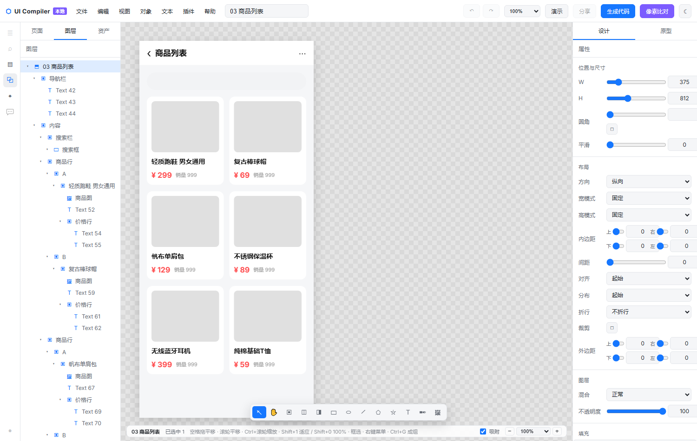
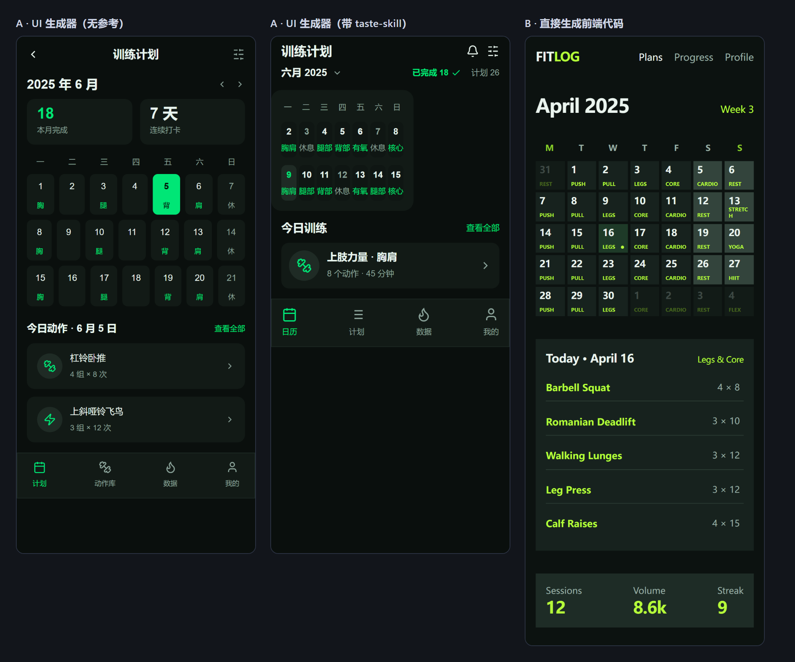
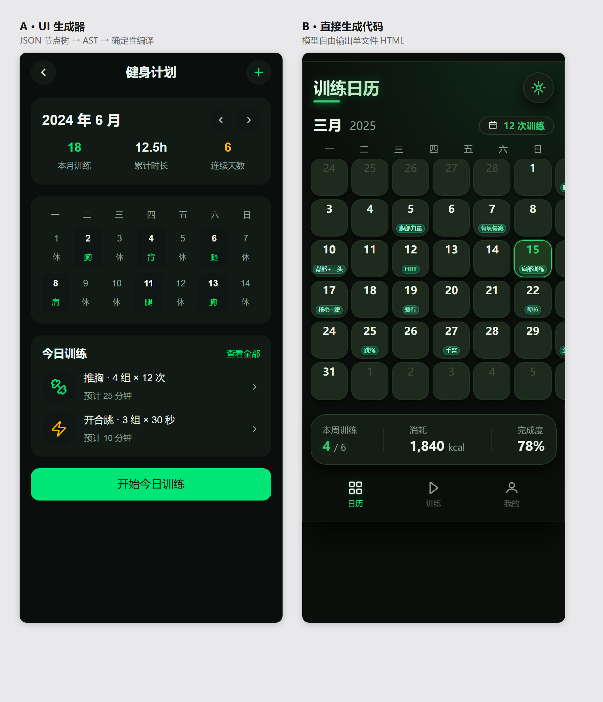
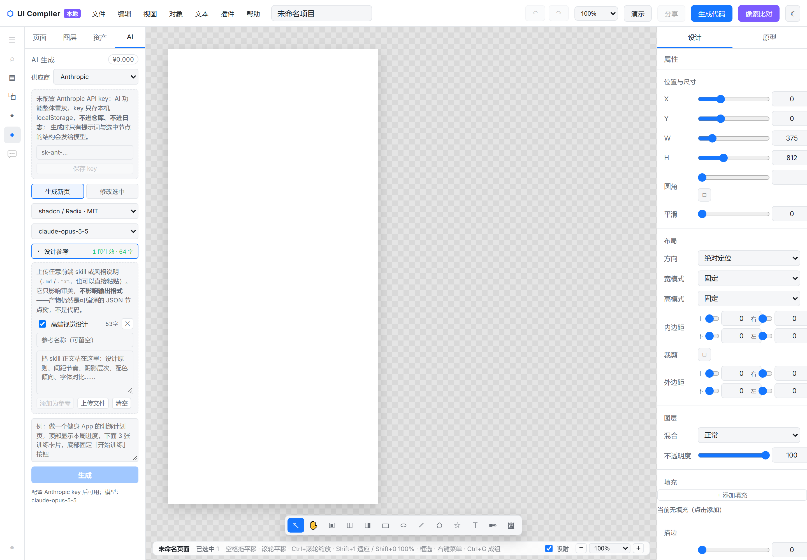
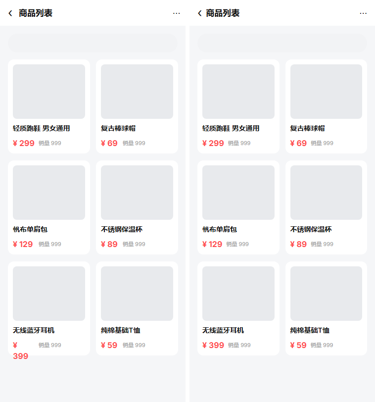
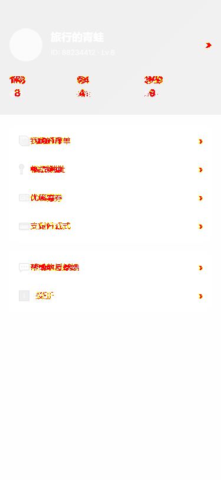
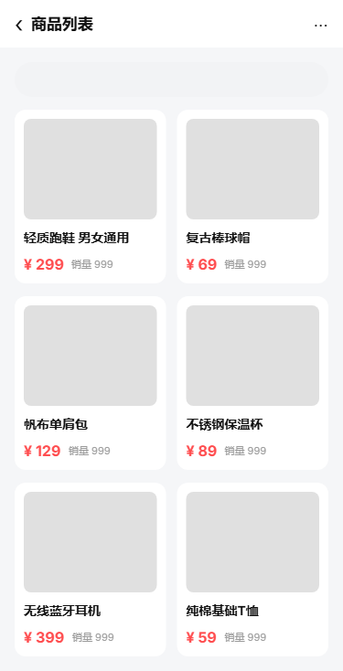
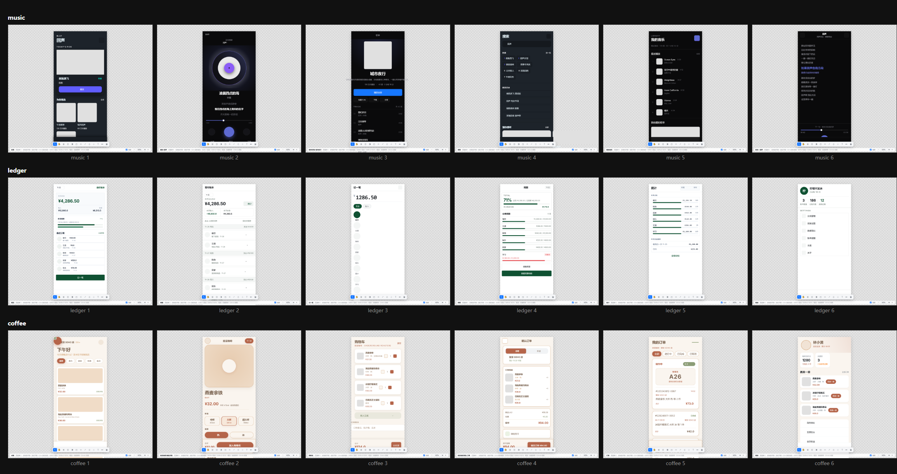

# UI Compiler — 结构化 UI 编译平台

> 把结构化的设计数据（UI AST）编译成**高还原、可维护、响应式**的前端代码，用**像素级对比（Pixel Diff）**量化验收，并与 **Figma 双向互通**（`.fig` 可读可写）。

设计稿到代码的主流做法是"截图 + 视觉猜测"，生成结果在间距、对齐和响应式上不可控。UI Compiler 反其道而行：先把设计数据解析为统一的 **UI AST**，交给确定性的 **Layout Compiler** 计算几何，再由 **Code Generator** 输出目标框架代码——链路上每一步都可测试、可回归。

**AI 只画草稿，编译 100% 确定性**：大模型产出的是符合契约的结构化描述，出码链路一个字节都不经模型。代价是模型用不上 CSS 全集；换来的是同一份产物**既能 `npm run build`，也能另存为 `.fig` 拖回 Figma 继续微调**——而不是"不满意就重新摇一次"。

```
提示词（可挂 Skill 参考）──► AI 契约草稿 ──► 闸门 + 自修环 ──► UI AST ◄──► .fig 双向（Figma 读写）
                                                               │
                                                               ▼
                                                    Layout Compiler（几何引擎）
                                                               │
                                                    Responsive Compiler（固定宽度 = 父宽 → 100%）
                                                               │
                            ┌──────────┬────────────┬───────────┴──────┬───────────┐
                            ▼          ▼            ▼                  ▼           ▼
                          React       Vue         Taro              uniapp     HTML 预览
                            └──────────┴─────┬─────┴──────────────────┴───────────┘
                                             ▼
                             工程包（npm i && npm run build）／渲染截图
                                             │
                              Pixel Diff ◄───┴────► 几何基准 reference（阈值 98%）
```

## 效果预览

**可视化编辑器**（React + Konva 画布：图层树 / 属性面板 / 拖拽缩放 / 代码生成 / 像素对比 / ZIP 与项目包导出）：



**同一段提示词、同一个 Skill 参考下的三向对比**——三栏依次是「契约通道·无参考」「契约通道·带参考」「模型自由写 HTML·带参考」。结论不粉饰：注入参考**改变的是审美取向，不是表达手段**，样式字段覆盖 8/37 → 8/37 一个没多，详见 `docs/ai-ab-report.md` §A。



**A/B 消融**（提示词逐字相同，A = 契约通道出码，B = 模型直出单文件 HTML；375×812 @DSF2，同一台 Chromium）：



**AI 面板**（配 key → 挂 skill → 写需求 → 生成 → 预览 → 采纳 → 导出整包）：



**Pixel Diff 对照卡**（左：Layout Compiler 几何基准 reference；右：编译产物 render）：



**像素差异热力图**（pixelmatch 逐像素，红色区域即差异所在）与**画布↔出码对比**（编辑器渲染 vs 编译产物渲染）：





**整站样片在编辑器画布上的实拍**（三个工程各 6 页，逐页切换截图）：



## 核心能力

- **Layout Compiler**：FIXED / FILL / HUG 三种尺寸语义 + HORIZONTAL / VERTICAL / ABSOLUTE 三种布局模式，解析出每个节点的绝对几何，作为像素对比的基准。
- **Responsive Compiler**：固定宽度恰好等于父级内容宽时自动转 `100%`；根节点 `width: 100%` + `min-height: max(Hpx, 100vh)`，**绝不写死视口宽度**。
- **Code Generator（四端）**：同一份 AST 生成 **React**（vite MPA，只出 H5）、**Vue**（同上）、**Taro**（小程序 + H5）、**uni-app**（产物即 `.vue` SFC，mp-weixin 已验），另出独立 HTML 预览与 `reference.html`。要用 vue3 语法出小程序走 uniapp 端，不走 vue 端。
- **`.fig` 双向**：内嵌官方 Figma 101 版 kiwi schema，导出能在 Figma 打开继续编辑，导入能回到 AST。见「Figma 互通」。
- **Pixel Diff**：reference（几何渲染）与 render（编译产物渲染）在同一浏览器、同视口下光栅化，pixelmatch 逐像素对比，**相似度阈值 98%**。
- **可视化编辑器**：拖拽、缩放、resize、图层树、属性面板、撤销/重做、矢量钢笔、原型连线与 Present 演示模式、代码生成、一键 ZIP / 项目包导出、未保存守卫（FR-60）+ 崩溃恢复。
- **AI 生成域**：提示词 → 单页 / 整站（2~6 页 + 确定性导航串联）；契约闸门 + 自修环 ≤2 轮；草稿先预览、采纳才落画布；7 家供应商 × 2 种协议；5 套风格包 + Lucide 图标 + 2 字体族；Skill 参考通道。
- **质量门禁**：四端「语法 / 类型 / 构建 / 像素」四关、`.fig` 四关、前端规范 8 域 12 条 + axe、45 场景实跑与渲染后量测。

## AI 生成

> 定位：**AI 只画草稿，编译 100% 确定性**。模型输出结构化描述 → schema 闸门 → 自修环 → 预览层（iframe 走真实出码）→ 采纳后才 dispatch。

### 表达通道：Tailwind className

模型手写 `widthMode` / `padding:[上,右,下,左]` 这类自造枚举字段等于**盲写**——它从未内化过这些名字；而 `flex items-center gap-3 px-4` 它在预训练里见过几百万次。所以换掉 AI 的**输入方言**，产物形态不变（仍是可编辑 AST，这也是能导出 `.fig` 的前提）：

- `src/editor/ai/tailwind.ts` 双向映射器：正向只覆盖能无损转换的受控子集，映射不了的一律进 `unknown` 并生成违例——**不静默丢弃**，因为"AI 写的"和"画布上看到的"不一致比报错更糟；显式字段仍可覆盖做精确控制；
- few-shot 语料从手写 layout 改为 className（覆盖率 100%）：反向映射表达不了的（`lineHeight` / `effects` / ABSOLUTE 坐标）才留显式字段，并逐字段 diff 保证样例与产物等价，**覆盖率 < 90% 直接 `exit 1`**；
- 实测真实调用：54 节点页面 **100% 用 className、0 个显式 layout、0 违例、首轮即通过**。编辑通道（修改选中）同步换成 className。

> 这里还修掉一个**测量 bug**：此前记录的"className 使用率 0%"是假的——旧探针统计的是编译后的 `UINode`，而 className 在 `draftToPage` 里就被消费掉、不落在 AST 上，无论模型怎么写都恒为 0%。改为统计模型原始输出才是真值。

### 归因：是"few-shot 没教"，不是"契约缺字段"

这条是用两轮对照实验换来的，也是本项目对 AI 能力最核心的判断：

| 实验 | 样式字段覆盖 | 结论 |
| --- | --- | --- |
| A 路径基线 | **8/37** | 37 个可用样式字段，模型只用了 8 个 |
| A + 注入 11.7K 字符真实 skill 参考 | **8/37（零变化）** | 自然语言的"期望"教不会它怎么写 |
| A + 补齐 4 个字段声明 + 8 条**字段级配方**（同格式示范） | **13/37** | `effects` / `decorations` / `grid` / `opacity` / `states` 开始被用，零丢失 |

**few-shot 是同格式的示范，skill 是自然语言的期望**——前者教"怎么写"，后者只说"要什么"。模型缺的是前者。

但同样要如实记下：配方轮的**成品质量没有提升，反而下降**（日历从 3 周缩到 2 周、底部导航消失、成本 +46%）。机制成立 ≠ 质量成立，实验完整数据在 `docs/ai-ab-report.md` §B。

### 供应商 × 协议（7 × 2）

| 供应商 | 协议 | 结构化输出 | 备注 |
| --- | --- | --- | --- |
| Anthropic | anthropic | `json_schema` | 原生强约束 + 显式 prompt caching |
| DeepSeek | anthropic 兼容端点 | 契约 + 闸门兜底 | 兼容层会**静默忽略** `output_config`（同提示词 4 次返回 4 种形状） |
| 千问 / 百炼 | openai | `json_object` | 默认关思考省输出 token；实测浏览器 CORS 可直连，不需要代理 |
| OpenAI | openai | `json_schema` | — |
| Gemini | openai 兼容层 | 契约兜底 | `json_schema` 支持有限 |
| Ollama（本机） | openai | 契约兜底 | 无需 key、不联网 |
| 自定义端点 | openai | 契约兜底 | 任意 OpenAI 兼容端点（vLLM / LM Studio / 内网网关） |

契约 schema 由 `ts-json-schema-generator` 从 `src/editor/ai/types.ts` 自动生成，`ajv` 运行时校验，违例摘要喂回自修。key 按供应商分槽存 `localStorage`，面板脱敏显示，**永不入仓库与日志**；未配 key 时 AI 功能整体置灰。

### 风格包与资产

5 套令牌包：`shadcn`（Radix Colors）/ `openprops` / `daisy-dark` / `blackgreen` / `forest`，构建期抽取为 `src/tokens/packs/*.tokens.json`；Lucide 图标路径 + Inter / Space Grotesk 可变字体，上游均为 MIT / OFL / ISC。`blackgreen` 是为 A/B 实验新建的——原三个包主色是紫 / 蓝 / 蓝，测"黑绿色健身 app"时模型无处可取。

### Skill 参考通道

把**任意前端 skill / 风格说明的纯文本**贴进来，作为「长什么样」的参考注入提示词。走文字层是因为各家 skill 目录结构不一（有的带 YAML frontmatter、有的带脚本、有的只有一段设计箴言），唯一稳定共有的层就是文字层——不需要理解它的结构，只要它描述审美的部分。这就是"强制兼容所有 skill"的落点。

- 参考注入**易变尾部**而不是 system 稳定前缀：缓存命中要求前缀逐字节一致，按项目变、随时会改的内容进前缀等于每次都让 prompt cache 失效；
- 真实 skill 是 20~40K 字符，提示词装不下。`selectSkillBody` 按二级标题切分，用"像不像约束"的特征词打分节选（rule / law / principle / 规则 / 原则 / 禁忌…），前言永远留 30% 预算，其余按分填，输出保持原文顺序。实测 39,499 字符 → 11,729，保住 `House rules` / `Laws of the craft`，丢掉流程说明。**朴素的 `slice(0, N)` 一个字都拿不到**——真正有指导力的内容在 28K 处。纯字符串启发式，不调模型。上限：单条 12,000 / 全部 16,000 字符、最多 12 条（再多只会互相稀释）；
- 注入前加硬隔离句，防模型把参考里的代码示例当成输出格式（契约闸门会把整页判违例，自修两轮救不回来）；
- 公平性口径：给了参考就**两条路径都给**，否则测的是"A 比 B 少一份参考"；
- **边界（诚实的部分）**：参考只影响审美，**不能**扩展输出契约——否则"确定性编译"就没了。实测注入后样式字段覆盖一个没多，还**诱发了偷懒**（节点 118 → 92，日历从 3 周缩到 2 周：学走了"去掉装饰"，没学"用尺度 / 内容 / 实拍图去填"），代价是 +31% 输入 token、+17% 成本、多烧一轮自修。它的定位是**审美微调，不是质量修复手段**：`docs/ui-quality-boost.md` 列的五条 UI 质量缺口，没有一条能靠 skill 修。

### 整站生成

`src/editor/ai/site.ts`：规划（1 次调用，输出站点名 + 2~6 个页面名 + 每页一句话 brief）→ 逐页生成（N 次调用，复用已验证的单页管线，每页预算与单页完全一致）→ 导航串联（**0 次调用，纯确定性**）。

为什么不"一次生成三页"：那是把输出预算摊成三份。实测模型的策略是**先砍内容再砍页**，结果三页都残缺——而且每页看起来都"像那么回事"，用户看不出哪里被砍了。

为什么导航是确定性代码：「点底部导航的『训练』跳到训练页」是**结构性事实**，不是审美选择。让模型逐条写 `interactions` 只会多一个出错面：漏一条不会有任何报错，而跳不过去是硬伤。更关键的是模型写不出页面 id（id 在转换时才生成），它只能写页面名——既然只能用名字，那就干脆在转换层按名字匹配，一次做对。匹配规则刻意**严格**：只认"文案去空白后与页面名完全相等"，不做包含匹配、不做同义词、不做编辑距离，因为**猜错（点「训练」跳到「我的」）比连不上更糟**——前者用户判定产品坏了，后者只是这一版还没做跳转。

### 实测口径

| 项 | 数据 |
| --- | --- |
| 场景全集 | **45** 个 · 9 组（导航 5 / 卡片 5 / 列表 5 / 表单 7 / 按钮 4 / 状态 4 / 数据 5 / 浮层 5 / 布局 5）· 优先级 10 / 15 / 20 |
| 实跑成本 | **¥0.011 每页**（`deepseek-v4.1-flash` @ 百炼端点，45 场景全链路跑通） |
| 评测轨 | `ai-matrix` 离线 **10/10** · 实跑 **13/13** |
| system 稳定前缀 | 11,363 / 12,000 tokens（B5 判据：第 2 页起 `cache_read > 0`，首轮是 cache 写入不计） |

> **反 bug 的层次设计**：45 个场景的产物先过 `ui-audit`（结构扫描）再过 `ui-measure`（**读渲染后的盒子**，6 类判据）。两个整页级真 bug 在 AST 里完全合法、结构扫描查不出，正是被后一层抓到的：① `{{icon}}` 占位符被闸门拒（`walkSpec` 跑在 repeat 展开之前，拿字面量查图标表必然查不到 → 模型连改 3 轮改不出来 → 抛异常）；② HUG + 显式高度被吞（`HUG → fit-content` 把显式 `height` 整个丢掉，底栏实际只剩 40px，文字底边落在视口第 811 行 / 视口 812）。

## Figma 互通（`.fig` 双向）

编辑器工具栏三个入口：`打开…（含 .fig）`（与自家 JSON 同一入口，按扩展名分派，用户不必记两种打开方式）· `导入 Figma 文件（.fig）…` · `另存为 Figma 文件（.fig）`。多页一并写出，Figma 侧打开就是多 Canvas。`.fig` 模块与 kiwi 运行时都是**动态 import**，主包不为它背 623KB。

导出侧踩过并根治的坑（细节都在 `src/fig/`）：

- **内嵌官方 Figma 101 版 schema**——`@open-pencil/kiwi` 自带的版本字段编号对不上，Figma 报 `Attempted to parse invalid message`；
- **data 段改 zstd raw-block 编码**——库的 `buildFigKiwi` 在 Node 下退化成 deflate，Figma 报 `Internal error during import`；
- **矩形类形状补 `fillGeometry`**——早先只有 VECTOR 写，218 个形状只有 12 个有几何，打开是一屏空白；
- **坐标统一走 `resolveLayout`**，删掉自研的 `measureTree` + `layoutChildren`——**两套布局引擎必然漂移**，实测 ironlog 348/369 节点位置错、最大偏 1411px；
- **脱流四类（`FIXED` / `STICKY` / `ABSOLUTE` / 带 margin 子项）统一写 `stackPositioning=ABSOLUTE`**；`FILL` 必须写 `FIXED`；HUG 带 min/max 或有 margin 子项也写 `FIXED`；
- **`ExtraNode.sizing` 旁挂原始 `widthMode` / `heightMode`**——Figma 会把 HUG / FILL 显示成 FIXED，不旁挂 AST 真值，就等于"存→开→存"逐次把自适应冻成硬编码。

导入侧同样是"两处口径必须一致"的坑：脱流子项坐标要减父 padding 与 margin（`.fig` 的 transform 相对父 border box，AST 相对内容盒）；有 `extras.sizing` 时跳过全部 FILL 启发式（`grow > 0` 与 `alignSelf = STRETCH` 都有歧义）；`ensureChildren` 与 `isContainer` 同口径——叶子被补 `children: []` 会让导出把 TEXT 当容器，`.fig` 里一个字都没有。

**`.fig` 表达不了的（如实登记，不做假兼容）**：伪类交互态（往返不保留）、`transform` 自定义原点（画布按元素中心近似）、Layout grid（导出降级为 CSS 可表达的等价 flex）。

门禁 `npm run fig:check` 四关：导入 4 文件 / 往返 20/20 / CSS 20/20 / 组件 4/4。排版另有独立检测器 `tests/helpers/figma-layout.ts`（按 Figma auto-layout 语义**独立重算**再比对）——**往返测试永远抓不到这类 bug**，因为 encode / decode 共用同一份 schema，错得一样就相互抵消。

## 快速开始

```bash
npm install
npm run dev         # 启动可视化编辑器
npm test            # 单测统一入口（固定 TEMP + 串行 + 校验收集文件数，防假绿）
npm run build       # 类型检查 + 构建编辑器到 dist/app（统一入口）
npm run ci-local    # 本地四门禁等价凭证（tsc / test / build / e2e）
```

编译与出码：

```bash
npm run e2e             # 生成 19 个测试页 → 截图 → Pixel Diff
npm run canvasdiff      # 画布↔出码对比（先 `npm run precanvasdiff`）
npm run showcase        # FR-57 样片：对照卡 + 五区审计 → dist/showcase/
npm run codegen:all     # 同一份 AST 出 react / vue / taro / uniapp 四端工程
npm run codegen:verify  # FR-75 四关门禁：语法 / 类型 / 构建 / 像素（每一关都真跑，不靠静态推断）
npm run bundle:verify   # 项目包四段：打包 / 解压（独立 `unzip -t` 逐条目 CRC，不自写 reader）/ 结构 / 体积
npm run bundle:e2e      # 走用户点到的同一条导出路径验收（避免"验收的"和"用户用的"是两份代码）
npm run nav:e2e         # 页面跳转通道端到端
npm run fig:check       # `.fig` 四关门禁
```

AI 与质量轨：

```bash
npm run ai:schema   # 契约 schema 再生成（改 `src/editor/ai/types.ts` 后必跑）
npm run ai:assets   # 风格包 / 图标 / few-shot 语料再生成（构建期，产物落库）
npm run ai-matrix   # 评测轨（离线档校验契约/语料/风格合规/出码链路；设 key 后跑 golden prompt）
npm run ui:gen      # 45 场景批量生成：AI_API_KEY=… --priority=all（--rebuild 不调模型只重跑管线）
npm run ui:shots    # 场景截图与联系表
npm run ui:measure  # 读渲染后的盒子做 6 类判据量测
npm run ui:audit    # 坏形态审计（--baseline 落基线，可 diff）
npm run standards   # 前端规范门禁：8 域 12 条规则 + axe on dist
```

编辑器走查与专项回归：

```bash
npm run walkthrough   # 编辑器走查（15 项，末尾三步常驻覆盖 .fig 入口）
npm run smoke-m1      # M1 画布冒烟
npm run smoke-m2      # M2 界面冒烟
npm run present-smoke # FR-44 Present 演示模式走查
npm run viewport      # 多断点无横向溢出 + 无兄弟重叠
npm run fr60          # FR-60 未保存守卫 + 千节点性能采样
npm run zip-assert    # FR-52 ZIP 产物断言
npm run recovery      # 崩溃恢复
```

> **链序提示**：改动 `src/` 后若直接跑 `present-smoke` / `canvasdiff` / 矩阵脚本，须先 `npm run precanvasdiff` 重建 e2e hook（`dist/app`），否则会拿旧构建得到假结果。
>
> **环境提示（Windows 本机）**：系统 Temp 受限会导致两类假象，均已封装进 `npm test` / `npm run build`：① `build` 报 `[vite:esbuild-transpile] ... Access is denied`（重试无效）；② **更危险**：vitest 的 SSR 缓存写 Temp 被拒 → 个别测试文件加载失败却**不计 failed**，汇总只报 `48 passed`（真实 50 文件，历史事件）。请走 `npm test`，并确认末尾的文件数校验行。
>
> **像素假红口诀**：`0.00%` 先怀疑截图（并发跑 `walkthrough` / `fr60` / `codegen:verify` 会抢字体导致截图超时），`9x.xx%` 再怀疑渲染。
>
> `npm run e2e` 若报 `SAFE_DELETE_BULK_CONFIRM_REQUIRED`，是沙箱拦 `rmSync` 批量删除（`dist/pages`、`dist/taro` 各 150+ 文件），命令前置 `CODEBUDDY_SAFE_DELETE_ENABLED=0` 即可。三坑细节与判据修正见 `docs/HANDOFF.md` §10.4。

`npm run e2e` 会在 `dist/pages/<页面>/` 下输出：

| 文件 | 说明 |
| --- | --- |
| `index.html` | 编译器输出的 flex CSS 渲染（render 侧） |
| `reference.html` | Layout Resolver 几何的绝对定位 DOM（reference 侧） |
| `reference.png` / `render.png` / `diff.png` | 两份截图与差异图 |
| `page.json` / `index.scss` | 页面 AST 快照与样式 |
| `geometry.json` | 节点几何快照（diff 区域归属） |
| `flows.json` | FR-57 原型 Flow 旁挂（仅含 Flow 的页产出） |
| `diff-report.json` | 逐页相似度报告（`dist/taro/<页面>/` 为 Taro 工程） |

## 测试页面（16 类布局场景 + 3 个 FR-57 样片页）

登录、注册、商品列表（双列网格）、商品详情（固定底栏）、订单列表、订单详情、个人中心（渐变头 + 统计）、设置（开关行）、Dashboard（柱状图）、表单（多行输入）、Card 列表（文字标签 chip）、Tab 页面（分段控件 + 底部栏）、绝对定位（海报）、长文本（换行）、图片密集（网格）、多层嵌套（FIXED/FILL/HUG 混合）。

样片三页（`src/demo/showcase.ts`，服务 FR-57 五区）：`17-样片-图层种类`（12 类图层 + 矢量/切片/分组）、`18-样片-参数矩阵`（四角圆角 / 描边三对齐 / 4 型渐变 / 8 类效果 / 约束 5 档 / AutoLayout / 文本排版 / blend）、`19-样片-原型跳转`（9 条交互 6 类动作 + 3 Flow）。

## Showcase 四个整站样片

`showcase/configs/{music,ledger,coffee,ironlog}.json` 定义 → `npm run showcase:gen` 生成 → 每个项目产出 6 页的四端工程包 + `.fig` + Figma 侧渲染对照图（`showcase/out/<项目>/figma-png/`）。四个工程合计 1800 节点，全部参与 `.fig` 排版 audit。

## 布局语义映射

| 设计语义 | CSS 输出 |
| --- | --- |
| `FIXED` | 固定像素；等于父内容宽时转为 `100%` |
| `FILL`（主轴） | `flex: 1 1 0` + `min-width/height: 0` |
| `FILL`（交叉轴） | `width/height: 100%` |
| `HUG` | `fit-content` + `flex: 0 0 auto`（绝对定位子节点为 `max-content`）；带显式高度时由 `normalizeHugSize` 给 `min-height` 地板 |
| `ABSOLUTE` 容器 | `position: relative`，子节点 `position: absolute` + `left/top`（相对父级 padding box） |
| 脱流四类（`FIXED`/`STICKY`/`ABSOLUTE`/带 margin 子项） | `.fig` 侧统一写 `stackPositioning=ABSOLUTE`；`FILL` 必须写 `FIXED` |
| `layout.clipContent` | `overflow: hidden`；**同时是 FR-23 蒙版组的显式开关** |

## 目录结构

```
src/
├── schema/       # UI AST：类型（NodeKind/SizeMode/LayoutMode/VectorData/StyleToken/decorations…）与工厂
├── compiler/     # measure（文本度量）→ layout（几何引擎 resolveLayout）→ compile（CSS 生成）
│                 # boolean/mask/tokens/imageAdjust：布尔、蒙版、设计 token、图片调整（纯函数单源）
├── generator/    # react / vue / taro-project / uniapp / HTML 预览 / reference DOM
│                 # vector(SVG)、prototype+runtime(FR-50)、bundle（四端项目包，UI 与脚本共用同一条路径）
├── fig/          # .fig 双向：codec / export / import / extras / figma-schema / zstd
│                 # / paint / path-blob / png / project
├── editor/       # 画布 / 图层 / 属性 / 撤销 / 代码 / Diff / 原型 / Present 演示 / 资产 / 项目守卫
│   ├── ai/       #   契约层：types · contract · tailwind · promptPack · iconVocab · styleRecipes
│   │             #   管线层：generate · specToPage · site（整站）· skills（参考通道）· aiActions
│   │             #   审计层：audit · bugscan/detectors · scenarios · scenarioChecks
│   │             #   接入层：client（7 供应商 × 2 协议）· AiDock 面板
│   └── tools/penCore  # 矢量路径纯函数
├── tokens/packs/ # 5 套风格包令牌（构建期抽取产物）
├── assets/icons/ # Lucide 图标路径数据（构建期产物，动态 import）
├── standards/    # 规范规则注册表（8 域 12 条，唯一真相源）+ 整站上下文
└── demo/         # DSL + 16 个测试页面 + showcase（样片三页）
scripts/          # 门禁与走查：build-pages / diff / canvasdiff / codegen / bundle / fig-check
                  # / standards / ui-{gen,shots,measure,audit,expect} / walkthrough / 冒烟与专项回归
tests/            # 93 个文件 / 1432 例（含 helpers/figma-layout.ts 独立重算器）
showcase/         # 四个整站样片工程（configs + out：四端产物 + .fig + Figma 截图）
docs/             # PRD / 对照矩阵 / A-B 实测 / 质量审计 / 规范 / HANDOFF 交接手册
```

## 技术栈

TypeScript · React 18 · react-konva · Vite 5 · Vitest 2 · Playwright · pixelmatch / pngjs · ajv（契约闸门）· ts-json-schema-generator · @open-pencil/kiwi（`.fig` schema 运行时，动态加载）· culori（色彩）· daisyUI / open-props / @radix-ui/colors（令牌数据源）· lucide-static（图标）· @fontsource-variable（字体）· axe-core

上游资产许可：daisyUI / Open Props / Radix Colors 为 MIT，Lucide 为 ISC，Inter / Space Grotesk 为 OFL。本仓库暂未附 `LICENSE` 文件。

## 限制与路线图

- Pixel Diff 基准视口为 375×812（`SHOT_WIDTH` / `SHOT_HEIGHT` 可覆盖）；**多断点像素 diff 待接入**（`viewport` 只断言横向溢出与兄弟重叠，不比像素）。
- 字体度量基于 Canvas 近似（Arial + 权重匹配规则），与浏览器在部分中英混排文本上存在 <5% 宽度误差；画布↔出码在混排长文本上有换行点位差异（14 页 92.07%，已登记差异 #1 豁免）。
- 矢量布尔为 **SVG 填充规则近似**（Union = nonzero，其余 = evenodd），Intersect 非严格几何交集；严格拓扑需引入裁剪库。
- 图片 7 项调整中，色温 / 色调 / 高光 / 阴影为 **CSS filter 近似**且画布不预览（Konva 无对应滤镜）。
- `codegen:verify` 有一处已知豁免：`taro:1`（长文本页）允许缺失（`--allow-miss taro:1`）。
- **AI 表达边界**：AST 是**属性闭包**，LLM 的搜索空间是 **CSS 全集**——这个差距是路线选择的结果，不是 bug。装饰层 DSL + 渐变描边（B1）、交互态（B2）、布局表达力（B3）已落地补齐第一批（`docs/expression-gap-plan.md`）；剩余瓶颈在 **few-shot 是否示范过**，而不在字段是否齐备（注入 11.7K 字符参考后 8/37 零改善，`docs/ai-ab-report.md` §A.4）。生成是**单轮结构化输出 + 自修 ≤2 轮**，未做多轮分块调用；编辑指令只覆盖白名单动作，白名单外一律拒绝执行。
- **FR-60 判据（已拍板，方案 A）**：PRD 字面「95% 帧 <16.7ms」经实证为 rAF 量化噪声指标（空白页亦仅 75~86%），主判据改为「**拖拽采样 ≥95% 帧按时（<1.5×vsync ≈ 25ms）**」——实测按时率 **95.27%**（掉帧 31/655）达标；原字面口径保留为参考信号 `fr60_legacyLiteral`。决议与实证见 `docs/go-no-go.md` 议题 1 / checklist 差异 #4。

## 验收状态

最近一次全量门禁（2026-11-03，`263629c`）：

| 门禁 | 结果 |
| --- | --- |
| `tsc --noEmit` | 0 错 |
| `npm test` | **1432 / 1432**（93 / 93 文件，收集数校验通过） |
| `npm run build` | ✓ |
| `npm run fig:check` | 四关 PASS（往返 20/20 · CSS 20/20 · 组件 4/4） |
| `.fig` 排版 audit | **0 差异**（demo 19 页 + 四工程 1800 节点） |
| demo 像素 | **19 / 19 ≥ 98%**（最低：16 层嵌套 99.18%） |
| `ai-matrix` | 实跑 13/13 · 离线 10/10 |
| `standards:check` | S1 12 条规则全有 fixture · S2 34 个 fixture 全过 · S3 16 次变异全变红 · S4 25 页 × 2 端 |
| `standards:a11y` | 25 页；`color-contrast` 命中 176 节点 / 22 页（真实基线，不做清零粉饰） |
| `recovery` | 12/12 |
| 走查矩阵 | **100%（70 PASS / 0 FAIL / 3 P2 对照声明）**，四模块全 100%（附 A 19/19 · 附 B 11/11 · 附 C 7/7 · 样片五区 5/5 avg 99.51%）→ ✅ **GO** |

> `ai-matrix` / `standards` / `recovery` / demo 像素四行为 2026-11-01 门禁记录，其余为 2026-11-03 最新一次。

**文档索引**

| 主题 | 文件 |
| --- | --- |
| 需求唯一凭据 / 逐日事实 / 交接手册 | `docs/PRD.md` · `LOG.md` · `docs/HANDOFF.md` |
| AI 双路径 A/B 实测（含 skill 消融） | `docs/ai-ab-report.md` |
| 表达力缺口补齐（B1 / B2 / B3） | `docs/expression-gap-plan.md` |
| UI 质量五条缺口的量化依据 | `docs/ui-quality-boost.md` |
| 前端规范 8 域 12 条 + 16 组冲突裁决 | `docs/frontend-standards-final.md` · `docs/standards-report.md` |
| 四端出码方案 | `docs/multi-target-codegen-plan.md` |
| 整站生成 / 小程序 | `docs/mall-miniapp-plan.md` |
| Figma 对照矩阵与差异报备 | `docs/figma-parity-checklist.md` |
| 审计与量测报告 | `docs/ui-audit-report.md` · `docs/ui-measure-report.md` · `docs/ui-expect-report.md` |
| GO / NO-GO 决议 | `docs/go-no-go.md` |

进度与剩余队列见 `docs/HANDOFF.md`；需求唯一凭据 `docs/PRD.md`；逐日事实 `LOG.md`；评审纪要 `docs/go-no-go.md`。
