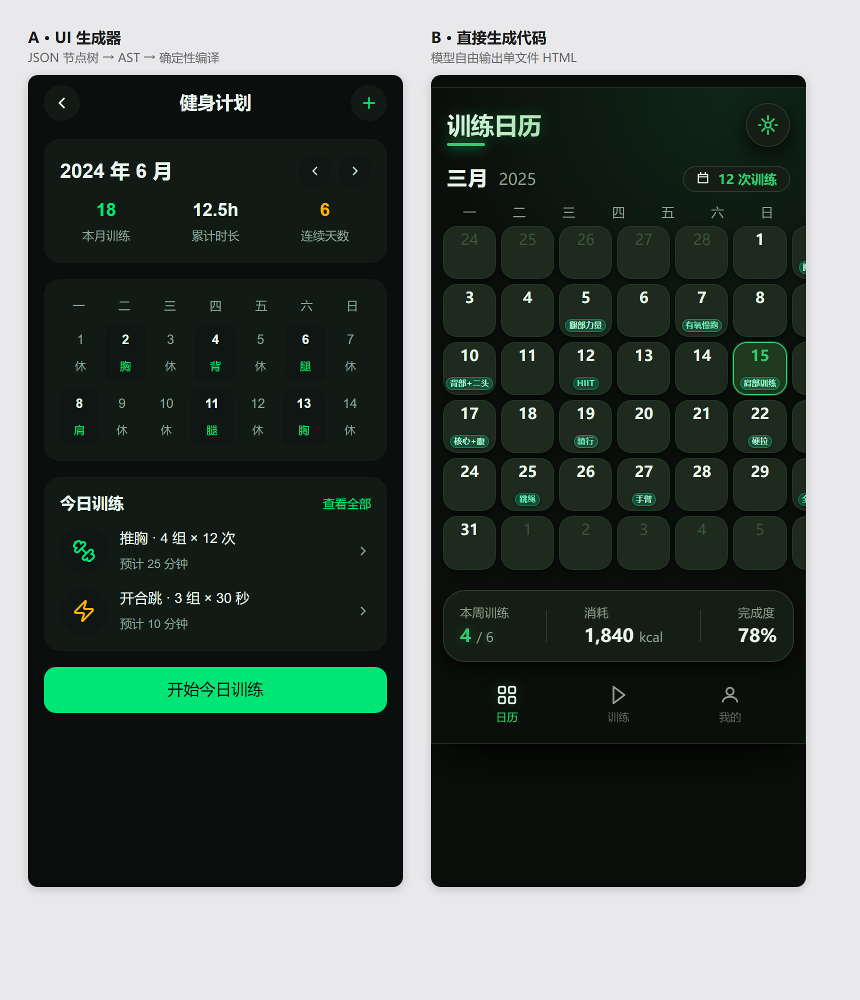
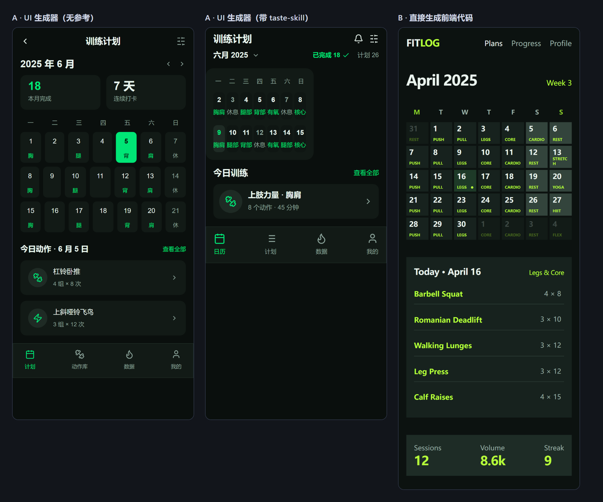
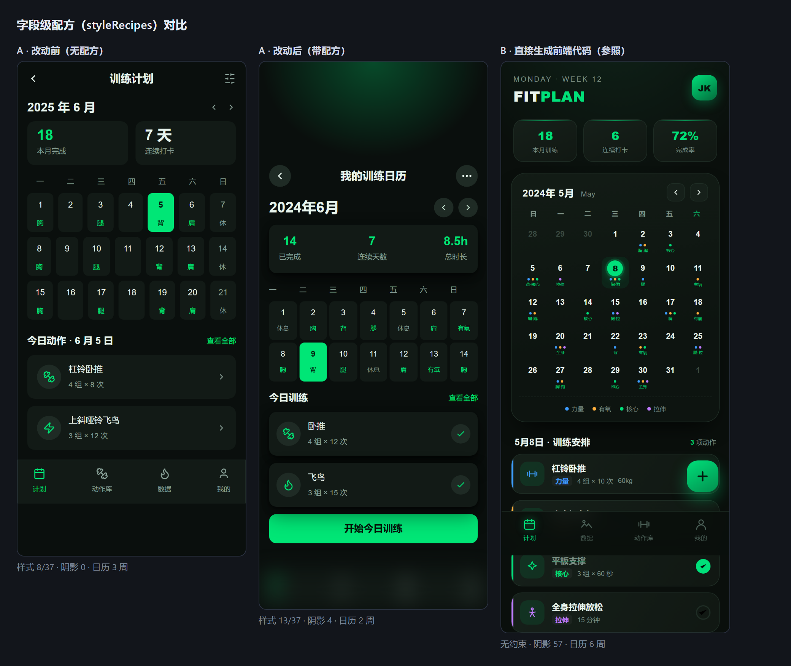
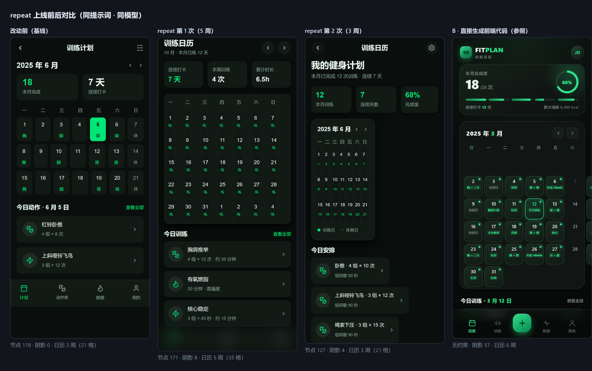

# AI 双路径 A/B 实测：UI 生成器 vs 直接生成代码（2026-10-27）

> 用户判断：「这样做出来的 UI 效果远差于直接生成代码，那没有这个功能的必要」。
> 本文用同一段提示词实跑两条路径，把「差距有多大」「差距从哪来」量化出来。
>
> 关联：`docs/expression-gap-plan.md`（2026-10-25）已经论证过「AST 是属性闭包、
> LLM 的搜索空间是 CSS 全集」，并给出装饰层 DSL 方案（B1/B2 已落地）。
> 本文是对该判断的**实测验证**，并把归因从「契约缺字段」修正为「few-shot 没教」。

## 1. 实验设计

| 项 | 设定 |
|---|---|
| 用户提示词 | `做一个健身计划app，显示出日历表格，对应的日期备注动作在日期上，主色调用黑绿色`（两条路径逐字相同） |
| 模型 | `deepseek-v4.1-flash`（千问/百炼 OpenAI 兼容端点，`enable_thinking:false` 两条路径同参） |
| 路径 A | `promptPack` 契约（JSON 节点树 + 令牌表 + 19 条 few-shot）→ `specToPage` → UIPage AST → `compilePage` → HTML |
| 路径 B | 模型自由输出单文件 HTML（内联 `<style>`，不限 CSS 能力） |
| 渲染 | 同一台 Chromium，375×812，deviceScaleFactor 2，`file://` 打开 |
| 风格包 | `blackgreen`（本轮新建；原三个包主色是紫/蓝/蓝，没有绿色） |

**system prompt 不同是故意的** —— 那正是两条产品路线本身的差异，真正的变量是「给模型什么契约」。

## 2. 结果



左 A、右 B。

| 指标 | A · UI 生成器 | B · 直接生成代码 |
|---|---|---|
| DOM 元素 | 117 | 160 |
| **阴影元素** | **0** | 57 |
| **渐变元素** | **0** | 2 |
| 圆角元素 | 16 | 57 |
| 唯一颜色 | 11 | 19 |
| 内联 svg | 8 | 5 |
| 文本节点 | 54 | 77 |
| 水平溢出 | 0 | 0（容器内把日历最后一列裁掉） |
| 产物体积 | 37,389 字符 | 14,270 字符 |
| 生成耗时 | 29.9s | 99.0s（网络波动，不可比） |
| 首轮通过 | 否（1 条违例 → 自修 1 轮） | — |

### 视觉差距的实质

- **B 的每个日期是独立卡片**（圆角 + 边框 + 底色），动作备注是 pill 标签；A 的日期只是文字，备注是纯文本。
- **B 有顶部光晕、卡片阴影、tab bar、徽章、标题下划线**；A 全部没有。
- **A 的日历只画了 2 周（1–14）**，B 画了完整 6 周 —— 模型偷懒，不是能力限制。
- **B 有布局缺陷**：日历 7 列超出容器宽度，最后一列被 `overflow` 裁掉（截图右侧可见半个格子）。

### 稳定性（同一提示词跑两轮）

| | 第 1 轮 | 第 2 轮 | 波动 |
|---|---|---|---|
| A 节点数 | 104 | 100 | **4%** |
| A 产物字符 | 38,125 | 37,389 | **2%** |
| B `<div>` 数 | 144 | 22 | **555%** |
| B 产物字符 | 17,811 | 14,270 | 25% |
| B 整页高 | 834px | 812px | 有差异 |

两轮 B 的视觉差异很大（第一轮更完整好看，第二轮有裁切），A 两轮结构几乎一致。
**确定性不只体现在编译，也体现在生成结果的稳定度上** —— 这是契约 + 闸门 + few-shot 的实际收益。

## 3. 归因（按贡献排序）

### 3.1 主因：few-shot 没教（可修，成本最低）

`AiStyleSpec` 里本来就有 `effects`（DROP_SHADOW / INNER_SHADOW / LAYER_BLUR）、
`decorations`、`states`、`transform`、`grid`、`opacity`、`letterSpacing`。
但 19 条 few-shot 的覆盖是：

| 字段 | 覆盖 |
|---|---|
| `effects` | 3/19 |
| `border` | 1/19 |
| `decorations` / `states` / `transform` / `grid` / `opacity` / `letterSpacing` | **0/19** |

A 实际只用到 8 个样式字段：`background, border, borderRadius, color, fontSize, fontWeight, lineHeight, textAlign`。

**结论：不是「写不了」，是「不知道能写」。** 契约字段齐全，提示词第 83 行也列了 `effects` 的写法，
但样例里零示范的字段，模型几乎不会主动用。

> **纠正**：此前一版分析把「`AiStyleSpec` 17 字段 / `StyleSchema` 37 字段 = 46%」当成表达力天花板，
> 并建议「补字段」。实测证明该判断错了 —— 字段大半已在，缺的是示范。补字段解决不了这个问题。

### 3.2 契约真缺口：填充渐变

`background` 只能写**单色**。渐变只有 `border.gradient`（描边用）。
`StyleSchema.fills` 支持多层填充与渐变填充，AI 契约没有对应字段 —— 这是真实的表达力上界。
B 的顶部光晕就是靠 `radial-gradient` 实现的，A 无法表达。

### 3.3 模型偷懒（非结构性）

A 的日历只展开 2 周。JSON 树要逐节点写，重复结构模型倾向省略；
B 写 HTML 时可以用循环/复制粘贴，更愿意写全。

### 3.4 出码冗长（无害）

A 的 HTML 是 B 的 2.6 倍：编译器给每个节点生成独立 class（带节点 id 前缀）。
体积大但没有视觉收益，属于既定取舍（类名全局唯一，换来构建稳定）。

## 4. 修复优先级

| 优先级 | 动作 | 成本 | 预期收益 |
|---|---|---|---|
| P0 | few-shot 补 3–5 条：带 `effects`（卡片阴影）、`border`（日期格子）、`decorations`、`states`（按钮 hover）的样例 | 低（改 `fewshots.json`） | 阴影 0 → 数十，border 1/19 → 多数样例 |
| P1 | `AiStyleSpec` 补 `fills`（多层填充 + 渐变填充） | 中（契约 + 转换器 + 出码） | 补上唯一真实的表达力缺口 |
| P2 | 提示词加硬规则：「日历 / 列表类结构必须完整展开，不得省略重复行」 | 低 | 治 3.3 的偷懒 |
| P3 | 让 `border-*` 在 className 里更易用（当前需宽度+颜色+样式三件套） | 低 | 日期格子卡片化 |

## 5. 结论

1. **视觉上 B 明显更强**，差距可量化（阴影 57:0、渐变 2:0、圆角 57:16）。
2. **差距主因不是架构，是提示词**：P0 一条改动（补 few-shot）就能吃掉大部分差距。
3. **A 的独有优势与本次对比无关但真实存在**：可编辑、可出四端、`.fig` 往返 19/19 零丢失、
   生成结果稳定（波动 4% vs 555%）。
4. **B 不是没有代价**：两轮里出现了一次容器裁切，且产物不可结构化编辑。
5. 产品叙事应放在「可编辑 + 可验证」，而不是「一句话出成品」—— 后者在效果上打不过 B，
   且这个差距由「受控契约」本身决定，不可能完全消除。

## 6. 复现

```bash
AI_API_KEY=sk-xxx AI_PROVIDER=qwen AI_MODEL=deepseek-v4.1-flash \
  npx vite-node scripts/ai-ab.ts
# 产物：.tmp/ai-ab/{A-ui-generator.html, B-direct-code.html, shot-*.png, report.json}
```

> 本轮顺带修掉一个真 bug：`specToPage` 里 VECTOR 图标的描边色读的是 `spec.style.color`
> 而不是合并后的 `vectorNode.style.color`，导致模型写在 `className` 里的 `text-*` 全部失效，
> 暗色主题下 7 个 svg 全部隐形（近黑背景 + `#111111` 描边）。
> 已在 `tests/ai-icons.test.ts` 加 3 条用例锁住，并验证「撤掉修复会变红」。

---

# 附录 A · 设计参考（skill 上传）实测（2026-10-28）

> 上一轮结论是「差距主因是 few-shot 没教」。自然的下一个问题：
> **那直接把一份顶级前端 skill 塞给模型，能不能补上？**
> 本节用同一提示词、同一模型，唯一变量是「是否注入 skill」，把这个问题量出来。

## A.1 实验设计

| 项 | 设定 |
|---|---|
| 用户提示词 | 与正文逐字相同（健身计划 + 日历表格 + 黑绿色） |
| 模型 | `deepseek-v4.1-flash`，`enable_thinking:false` |
| 唯一变量 | `AI_SKILL_FILE` 是否设置 |
| 参考来源 | [`leonxlnx/taste-skill`](https://github.com/Leonxlnx/taste-skill) 的 `SKILL.md`（39,499 字符，安装量 674K，A 类风格 skill 的代表） |
| 注入量 | 39,499 → 归一化 **11,729** → 注入 **11,745** 字符（去 frontmatter + 按章节节选） |
| 公平性 | 给了参考就**两条路径都给**（B 的 system 同样追加），否则测的是「A 比 B 少一份参考」 |
| 样本 | 每侧 1 次（生成有随机性，本节只谈量级，不当精确值用） |

## A.2 结果



| 指标 | A 无参考 | A 带参考 | B 带参考 |
|---|---|---|---|
| 节点数 | 118 | **92**（−22%） | 117 个 div |
| 样式字段覆盖 | 8/37 | **8/37（零变化）** | 无约束 |
| 阴影节点 | 0 | **0** | 有 |
| 渐变 | 0 | **0** | 0 |
| 圆角档数 | 3 | 4 | — |
| 字号档数 | 7 | 6 | — |
| 唯一颜色 | 8 | 8 | — |
| 首轮通过 | ✅ | **❌**（2 条违例，自修 1 轮） | — |
| 输入 token | 9,939 | 13,039（+31%） | — |
| 成本 | ¥0.0300 | ¥0.0350（+17%） | — |
| 日历完整度 | 3 周（1–21） | **2 周（2–15）** | 6 周 |

## A.3 结论

**1. 机制完全跑通，且没有污染输出契约。**
11.7K 字符的参考（含大量 HTML/CSS 示例、shell 命令、`scripts/draw.mjs` 调用）注入后，
模型产出的仍然是**合法 JSON 节点树**，没有一段代码混进输出。
这说明 `designRefBlock` 的硬隔离句是必要的且有效的——不加这句，参考里的代码示例
极可能被当成输出格式（契约闸门会把整页判违例，自修两轮救不回来）。

**2. 参考改变的是「审美取向」，不是「表达手段」。**
样式字段覆盖 **8/37 → 8/37，一个没多**；阴影仍 0、渐变仍 0。
视觉上确实变平了（日历从「一排圆角卡片」变成「无框表格」、装饰减少、强调色收敛到一处），
这符合 taste-skill 的 House rules（`No shadows on things at rest` / `No gradients` /
`Surfaces are separated by a small step in tone`）——但**没有长出任何一个新字段**。

**3. 更糟的是：它还诱发了偷懒。**
节点 118→92，日历从 3 周缩到 2 周。
taste-skill 自己在开头就警告过这个失败模式：
> Taking the ornaments away is only half the job; a page that has lost its labels, rules and cards
> and gained nothing in their place reads as thin.

模型学到的是「去掉装饰」，没学到「用尺度/内容/实拍图去填」。**这份参考的负面作用大于正面**。

**4. 代价是确定的，收益是不确定的。**
+31% 输入 token、+17% 成本、多一次自修（首轮通过 true→false）。

## A.4 这一节推翻了什么

- ❌ **「补 skill 能解决效果差距」——被证伪。** 至少对「让模型用起 `effects`/`decorations`」无效。
- ✅ **「差距主因是 few-shot 没教」——再次被支持。** few-shot 是**同格式的示范**
  （`{"kind":"FRAME","style":{"effects":[...]}}`），skill 是**自然语言的期望**
  （「阴影要克制」）。前者教「怎么写」，后者只说「要什么」。模型缺的是前者。
- ✅ **「字段不够用」仍是次要问题**：8/37 的覆盖在注入 11.7K 字符参考后没有任何改善，
  说明当前瓶颈不在「有没有字段」，而在「模型想不想用、会不会用」。

## A.5 顺带解决的一个真问题：截断位置

真实 skill 的量级是 20~40K 字符，提示词装不下。朴素的 `slice(0, N)` 拿到的是开头的
自我介绍与工作流程（「先读 brief、再跑脚本」），而真正有指导力的
**House rules / Laws of the craft 在 28K 处**——按前 12K 截断一个字都拿不到。

因此 `skills.ts` 实现了 `selectSkillBody`：按二级标题切分，用「像不像约束」的特征词打分
（rule/law/principle/规则/原则/禁忌…），**前言永远留 30% 预算**，其余按分填，
输出保持原文顺序。实测这份 39.5K 的 skill 被节选为 11.7K，保留
`House rules` / `Laws of the craft` / 前言，丢掉 `The run` / `Files` / `Special cases`。
纯字符串启发式，不调模型。

## A.6 复现

```bash
# 抓真实 skill（curl 走系统代理可能失败，用 node fetch）
node -e "fetch('https://raw.githubusercontent.com/Leonxlnx/taste-skill/main/skills/taste-skill/SKILL.md').then(r=>r.text()).then(t=>{require('fs').mkdirSync('.tmp/skills',{recursive:true});require('fs').writeFileSync('.tmp/skills/taste-skill.md',t)})"

# 带参考
AI_API_KEY=sk-xxx AI_PROVIDER=qwen AI_MODEL=deepseek-v4.1-flash \
  AI_SKILL_FILE=.tmp/skills/taste-skill.md AI_RUN_LABEL=skill \
  npx vite-node scripts/ai-ab.ts

# 同指标基线（唯一差别是不设 AI_SKILL_FILE）
AI_API_KEY=sk-xxx AI_PROVIDER=qwen AI_MODEL=deepseek-v4.1-flash \
  AI_RUN_LABEL=noskill npx vite-node scripts/ai-ab.ts

# 拼对比图
npx vite-node scripts/ai-ab-compare.ts
```

## A.7 产品结论

**功能保留，但不作为「提升效果」卖点。** 它的真实价值是三条：
1. **审美对齐**：把团队/客户的设计规范贴进去，产出会朝那个方向收（本轮已证实）；
2. **强制兼容**：任何 skill（Workbuddy / Claude / Cursor 各一套目录结构）都能用，
   因为只取文字层，不解析结构；
3. **可分享**：参考随工程文件走（`SerializedProject.aiSkills`），换台机器审美一致。

**不要指望它补表达力。** 要补表达力只有两条路：
补 few-shot（P0，教「怎么写」）、补 `fills`（P1，补真缺口）。

---

# 附录 B · 字段级配方（styleRecipes）实测（2026-10-28）

> 附录 A 的结论是「skill 教的是想要什么，few-shot 才教怎么写」。
> 那么按这个逻辑补 few-shot，应该能补上差距。本节就是去验证这句话。

## B.1 先发现了一个更靠前的原因

准备动手时先 grep 了一遍提示词，结果：

```
$ grep -n "decorations\|states\|grid\|transform" src/editor/ai/promptPack.ts
73:  不支持 md:/hover: 等变体前缀、grid、gap-x/gap-y、单角圆角——出现即被判违例
```

**四个字段在提示词里零命中。** 而它们在 `AiStyleSpec` 里有定义、在
`contract.page.schema.json` 里有 schema、在 `specToPage.ts` 里有转换、在
`compile.ts` 里有出码（grid 17 处 / decorations 5 处 / states 4 处 / transform 7 处）。

也就是说：**字段全链路都实现了，只有提示词没说。** 模型不知道能写，就永远不写。
门禁全绿，字段从没被用过——这是「假绿」最标准的形态，比缺字段更难发现。

所以附录 A 的归因「few-shot 没教」还不够准确。真正的排序是：

1. **契约块没声明**（最靠前，改一行就能修）
2. few-shot 没示范写法
3. 模型偷懒

## B.2 改了什么

| 改动 | 位置 | 说明 |
|---|---|---|
| 契约块补齐四个字段 + `border.gradient` | `promptPack.ts` `CONTRACT_BLOCK` | 声明「能写什么」 |
| 硬规则给阴影开 rgba 例外 | `promptPack.ts` `RULES_BLOCK` | 否则「禁止包外色值」和「阴影必须半透明」互相打架，模型只能不写 |
| className 的 grid 禁令说清出口 | 同上 | 原文只说「不支持 grid」，没说「改用 style.grid」，模型会绕开 |
| 新增 8 条字段级配方 | `styleRecipes.ts`（新文件） | 示范「怎么写」，稳定前缀常驻 |
| 17 条测试 | `tests/ai-style-recipes.test.ts` | 每条配方在 4 个风格包 × 两段校验下必须零违例 |

**配方不是随便写的示例**，每条都过两段校验：
`validateAiOutput`（ajv schema）+ `draftToPage`（className 白名单、令牌解析）。
只跑前者会得到假绿——`className="grid grid-cols-7"` 在 schema 层永远合法，
真正的违例在转换层。这一点是测试第一版踩出来的，已写成反向用例锁住。

## B.3 结果（同提示词，两轮）



| 指标 | A 改动前 | A 带配方 #1 | A 带配方 #2 | B 直接写代码 |
|---|---|---|---|---|
| 样式字段覆盖 | **8/37** | **13/37** | **11/37** | 无约束 |
| 阴影节点 | **0** | **4** | **2** | 57 |
| `decorations` / `states` / `grid` | 无 | **有** | **有** | — |
| 渐变 | 0 | 0 | 0 | 2 |
| 节点数 | 118 | 113 | 113 | 67 div |
| 每节点输出 token | 26.7 | 30.6 | 31.2 | — |
| 首轮通过 | ✅ | ✅ | ✅ | — |
| 日历完整度 | 3 周 | **2 周** | **2 周** | **6 周** |
| 底部导航 | 有 | **无** | **无** | 有 |
| 输入 token | 4,036 | 5,306 | 5,306 | — |
| 成本 ¥ | 0.0130 | 0.0190 | — | — |

**新增字段：`effects`、`decorations`、`grid`、`opacity`、`states`——零丢失。**

## B.4 结论

**1. 机制成立，而且因果链是干净的。**
四个字段从「提示词里没有」到「提示词里有」，模型立刻开始用；两轮都稳定。
这不是运气，是「声明 → 使用」的直接因果。**假绿问题修掉了。**

**2. 但成品质量没有提升，反而下降了。**
日历从 3 周缩到 2 周、底部导航消失。视觉上确实多了光晕和阴影（更像「有设计感」），
但结构完整度明显退步。两轮都是 2 周，不是随机。

**3. 原因不是模型偷懒，是「输出预算零和」。**
每节点输出 token 从 26.7 涨到 30.6（+15%）——因为每个节点现在要多写 `effects`/`states`。
输出总量几乎没变（3153 → 3456），于是**能画的节点数少了**。
节点从 118 掉到 113，少掉的那几个正好是导航栏和两周日历。

**4. 所以附录 A 的归因要再修正一次。**
不是「few-shot 没教」，也不是「字段不够」，而是：
**AST 的信息密度低于 HTML，在固定输出预算下必然画得更少。**

对照组的 67 个 div 画完了 6 周日历 + 图例 + 导航 + 3 张卡；
AST 用 113 个节点只画了 2 周日历 + 2 张卡。
每个 AST 节点有固定开销（`kind` / `name` / `className` 骨架约 60~80 字符），
HTML 的 `<div class="cell">14</div>` 只要 30 字符。**贵一倍，画一半。**

这是架构取舍，不是 bug——AST 的冗余正是它能被精确编辑的原因。
但它意味着：**补提示词永远追不上代码路径的内容量。**

## B.5 唯一可能反超的地方

AST 有一件事 HTML 做不到：**表达重复**。

日历 6 行 × 7 列，HTML 必须写 42 个 `<div>`；
AST 可以写「一个格子模板 + `repeat: 6`」。这是 AST 独有的压缩能力，
现在完全没用上——模型老老实实画了 14 个格子。

如果要做，形状大概是：

```json
{"kind":"FRAME","style":{"grid":{"columns":"repeat(7, 1fr)"}},
 "repeat":{"count":42,"template":{...日期格...},"bind":"dates"}}
```

代价：新增 `repeat` 字段要改 9 处（类型、出码、画布、`.fig` 读写、契约、转换器、
比对白名单、属性面板、测试），且展开后必须能被编辑器逐个选中——
即「编译期展开成 N 个节点」，AST 存的是模板而不是实例。

**这是目前唯一能同时赢「内容量」和「可编辑性」的方向。**
比继续补 few-shot 有价值，但工作量是周级，不是天级。

## B.6 复现

```bash
# 改动后（配方已进提示词，无需额外参数）
AI_API_KEY=sk-xxx AI_PROVIDER=qwen AI_MODEL=deepseek-v4.1-flash \
  AI_RUN_LABEL=recipes npx vite-node scripts/ai-ab.ts

# 拼三栏对比图
AI_CMP_SET=recipes npx vite-node scripts/ai-ab-compare.ts
```

门禁：`tsc` 0 错 · `vitest` **948/948**（65 文件）· `npm run build` OK。

---

# 附录 C · `repeat`（结构级重复）实测（2026-10-28）

> 附录 B 的结论是「AST 信息密度低于 HTML，补提示词追不上内容量」。
> 唯一的反超机会是**表达重复**：HTML 必须写 42 个 `<div>`，AST 可以写「一个模板 + repeat 6」。
> 本节就是去验证这句话能不能兑现。

## C.1 设计：repeat 只活在 AI 契约层

关键决策：**repeat 不进 AST**。

它和 `className` 是同一类东西——**方言**。模型用它压缩输出，转换层确定性展开，
展开后就是 N 个普通节点，AST 里查不到任何 `repeat` 痕迹。

| 层 | 是否有 repeat 概念 |
|---|---|
| `AiNodeSpec`（AI 契约） | ✅ 有 |
| `contract.page.schema.json` | ✅ 有（从 TS 类型自动生成） |
| `specToPage.expandRepeats`（转换层） | ✅ 展开点 |
| `UIPage` / `UINode`（AST） | ❌ **没有** |
| 编译器 / 画布 / `.fig` 读写 / 比对口径 | ❌ 零改动 |

代价是「改模板不影响实例」——那是完整版（AST 原生支持）才有的能力，
需要引入 Figma 的 component-instance 那套概念，是另一个量级的改动。
本轮先验证「压缩输出预算能不能换来更多内容」，再决定要不要投那一笔。

**证据：`npm run fig:check` 三关全 PASS（19/19 页结构无损、19/19 样式一致）。**
如果 repeat 漏进 AST，往返关会立刻变红。

### 语法

```json
{"kind":"FRAME","name":"日期格","repeat":{"count":35},
 "children":[{"kind":"TEXT","text":"{{index}}"}]}
```

| 占位符 | 含义 |
|---|---|
| `{{value}}` | 依次取 `repeat.values`，长度不够循环 |
| `{{index}}` | 1 起序号 |
| `{{index0}}` | 0 起序号 |

`name` 自动补序号（`日期格 1`…`日期格 35`），否则图层面板会显示 35 个同名节点。

### 两条硬约束

1. `count ≤ 60`，展开后总节点 `≤ 800`。超限报违例，不静默截断。
2. **先展开子节点，再替换本层占位符**。反过来的话父层的替换会吃掉子层的 `{{index}}`，
   子 repeat 永远拿到父层序号（日历里每格的小标签会全变成同一个数字）。
   这条由单测锁住，反向验证过。

## C.2 顺带修掉的一个真缺口：margin

上线 repeat 后首轮违例里 3/4 是 `mt-4` / `mx-4`。查下来是**第三例「字段在、通道不在」**：

| | padding | margin |
|---|---|---|
| `LayoutSchema` | ✅ | ✅ |
| `compile.ts` 出码 | ✅ | ✅ |
| `AiLayoutSpec` | ✅ | ❌ **没有** |
| `className` 解析 | ✅ `p*/px/py/pt…` | ❌ **没有** |

模型写 `mt-4` 就进违例清单，而这是 Tailwind 最高频的几个类之一。补齐后首轮通过率从 1/3 回到 2/3。

`m*-auto` 仍然不支持（`BoxPadding` 是纯数值四元组），但错误提示里直接给了替代写法
（`items-center` / `justify-center`），不让模型反复试。

## C.3 结果



生产配置（`maxRepair: 2`）连跑 5 次：

| 指标 | 基线 | repeat | 变化 |
|---|---|---|---|
| **节点数** | 118 | **172.3**（167~182） | **+46%** |
| **日历数字文本** | 21（3 周） | **37.5**（37~38） | **+79%**（≈5.4 周） |
| 阴影节点 | 0 | 4~8 | 从 0 起 |
| 通过率 | ~100% | **4/5** | −20pt |
| 首轮通过 | ~100% | **3/5** | −40pt |
| 每节点输出 token | 26.7 | 27.4 | **持平** |

**关键一行是最后一行**：节点多了 46%，但每节点成本没涨。
这正是 repeat 的作用——省下的格式开销被换成了内容。

## C.4 结论

**1. 「表达重复」确实是 AST 的反超点，假设成立。**
日历从 3 周变 5 周以上，节点 +46%，每节点成本持平。
这是本轮唯一一次**内容量**上的实质提升（前两轮都只是字段覆盖率提升）。

**2. 代价是首轮通过率下降（100% → 60%）。**
新增了出错面：`values` 该写在哪一层、占位符拼写、嵌套层级。
两轮自修后通过率 80%，仍在可接受范围，但比之前差。

**3. 有一个刻意的取舍：`{{value}}` 缺 values 时降级成序号，不报违例。**
早期版本报违例，实测代价太大——模型在深层嵌套里把 `values` 写到错的层上，
一条违例就让整页失败，自修两轮也未必改对。
降级后第 N 格显示 N，用户看到的是数字日历，不是空白也不是报错。
副作用是偶尔出现「每行标注 1~7 循环」这种怪样子（见对比图第 3 栏），但页面能用。

**4. 仍未追上的部分：视觉丰富度。**
对照组（第 4 栏）有彩色圆点、图例、进度环、底部导航、每格三种状态；
repeat 版结构够完整，但装饰手段仍少。那是 `fills`（填充渐变）和 few-shot 的问题，
不是 repeat 的问题。

## C.5 下一步

| 优先级 | 事项 | 理由 |
|---|---|---|
| P0 | `repeat` 扩展到**编辑器**（模板/实例两层） | 现在展开后改一个格子不影响其他 34 个。这是「设计稿」该有的能力，也是周级工作量的主体 |
| P1 | 图标名别名表 | 目前唯一的偶发违例来源（`chart` vs `chart-bar`），补别名比让模型重试便宜 |
| P2 | `fills`（填充渐变） | 唯一真表达力缺口，但优先级低于「内容量」 |
| — | `justify-around/evenly` | `JustifyMode` 只有 4 档，加档要动 AST + 出码 + `.fig`，暂不划算（提示词已说明用 gap 代替） |

## C.6 复现

```bash
# 连跑 5 次统计分布（生产配置）
AI_API_KEY=sk-xxx AI_PROBE_RUNS=5 AI_MAX_REPAIR=2 npx vite-node scripts/probe-repeat.ts

# 单次 A/B + 拼图
AI_API_KEY=sk-xxx AI_RUN_LABEL=repeat npx vite-node scripts/ai-ab.ts
AI_CMP_SET=repeat npx vite-node scripts/ai-ab-compare.ts
```

门禁：`tsc` 0 错 · `vitest` **975/975**（67 文件）· `build` OK · `fig:check` 三关 PASS。

---

# 附录 D · 立体物件（3D 电动车）实测（2026-10-28）

> 题目：**「生成一页电动车控制应用，显示电量位置，还要一个 3d 的电动车居中位置」**
>
> 这题故意挑了一条会撞边界的需求：本项目 `TransformSchema` 只有 2D 六字段
> （`rotate` / `scaleX` / `scaleY` / `translateX` / `translateY` / `origin`），
> 没有 `perspective` / `rotateX` / `rotateY` / `translateZ`。
> 目的不是再赢一次，而是**量出「受控子集」在自由绘图上的真实边界在哪**。

## D.1 实验设计：为什么这一轮没调真实模型

本机没有任何供应商 key（`AI_API_KEY` / `DEEPSEEK_API_KEY` / `DASHSCOPE_API_KEY` 均未设置，
无本地 ollama），`runPageGeneration` 跑不了。于是把**模型那一环固定**：

| 路径 | 做法 |
|---|---|
| A | 同一个智能体手写 `AiPageDraft` JSON（受契约约束）→ `draftToPage` → `compilePage` → `generateHtml` |
| B | 同一个智能体直接写单文件 HTML（无约束） |

这比调外部模型**隔离得更干净**：外部模型两次调用自带随机性，而这里「模型能力」被完全固定，
剩下的差异只可能来自**格式约束本身**——正好是项目要证明的命题。

**局限（必须写进结论）**：没经过 `runPageGeneration`，所以「一次通过率 / 成本 / 耗时」
这三项**不可测**。产物可信，过程指标不可测。要补这三项需要 key，命令见 D.6。

## D.2 结果

| 指标 | A · AST 编译 | B · 直接写码 |
|---|---|---|
| 结构单元 | **61 个节点** | 24 个 div |
| HTML 体积 | **24 494 字符** | 11 620 字符 |
| 契约违例 | 0 | 无此概念 |
| 矢量 path | 13（几何拼装的圆/圆角矩形） | 17（手绘车身） |
| 真 3D（perspective / rotate3d） | **不支持** | 有（`perspective:900px` + `rotateY(-17deg)`） |
| 渐变 / 阴影 / 伪类 / filter / 动画 | 有（渐变 3 · 阴影节点 9 · 交互态 4） | 全有（含 `@keyframes` 浮动） |

产物：`docs/images/ai-ab-3d-A-ast.png`、`docs/images/ai-ab-3d-B-code.png`。

**A 的产物长这样**：一辆用 6 个几何部件拼出来的侧视滑板车（前后轮 / 踏板 / 立管 / 车把 / 座垫），
带地面光晕、硬阴影、SPOTLIGHT 背光。**能看出是车，但没有 3D 感**——它是 2D 侧视图 + 光影暗示。

**B 的产物长这样**：手绘 SVG 车身（含挡泥板、仪表、车灯、踏板纹理），`rotateY` 让整车真的立在
3D 空间里，配地面倒影（`scaleY(-1)` + mask 渐变）、透视网格地面、浮动动画。

## D.3 四个硬边界（都是这轮踩出来的，不是猜的）

### ① VECTOR 图标永远是 24×24，`layout.width` 被忽略

> **2026-10-28 追修：这条不是设计，是 bug，已修。** 详见 D.7 ①。
> 下面保留的是当时的现场记录（含「这是刻意设计」这个**错误**结论），
> 留着是因为它正好演示了「把 bug 读成设计」是怎么发生的。

`specToPage.ts:450` 把矢量硬写成 `{ d, width: 24, height: 24 }`，而
`svgOfVector` 里 `const w = Math.max(d.width ?? width, 0)` —— **`d.width` 优先于 layout**。

所以 `{"kind":"VECTOR","icon":"bike","layout":{"width":152,"height":152}}` 产物是
`<svg width="24" height="24">`。第一版 A 通道就是这样：整辆车缩成一个 24px 小点，肉眼看不见。

~~这是**刻意设计**（代码注释写明：图标路径按 24×24 绘制，盒子拉伸会让 stroke 变粗变糊），
代价是「画一个大号矢量图形」在 A 通道里**没有入口**——只能用 OVAL/RECTANGLE 几何拼装。~~

**实际结论**：注释里写的顾虑（放大后 stroke 变粗糊）是**真问题**，但「锁死 24」是**错解**——
正解是把 viewBox 与渲染尺寸解耦 + stroke 反算（`stroke-width = 声明值 / scale`）。
锁死同时牺牲了「缩小」（14/18/22 全出 24px），而反算两头都对。**一个正确的顾虑推导出了错误的约束。**

### ② OVAL 上加 `effects` 会渲染成方框

OVAL / POLYGON / STAR 走 SVG 通道（`isShapeSvgNode`），而 `box-shadow` 作用在
SVG 元素的**矩形盒**上。于是「给圆轮子加发光」的结果是：圆环外面套一个**方形光斑**。

第一版 A 通道的轮子就是两个黑方块。修法：光晕用「圆角矩形 + `LAYER_BLUR`」垫在下面，
OVAL 只负责描边。

### ③ ABSOLUTE 容器缺省 HUG → 高度塌成 0

舞台写了 `{"mode":"VERTICAL","height":260}`，产物里 `height: 300px` 那行确实在，
但**整块高度是 0**——因为 `heightMode` 缺省是 HUG，而子项全是 ABSOLUTE（不占流），
HUG 算出来的自然高度就是 0。必须显式写 `"heightMode":"FIXED"`。

这一条最阴：schema 不报错、违例 0 条、`height` 字段也在产物里，但视觉上整个舞台消失。
只有截图能发现。

### ④ 图标词表里没有电动车

`ICON_VOCAB` 里最接近的是 `bike` / `car` / `battery` / `gauge`，没有 scooter / 电动车。
这不影响结论（图标本来就不能放大），但说明「词表覆盖」和「图形表达力」是两件事。

## D.4 结论

**A 通道赢了什么**

- **每个部件都是独立可编辑节点**。后轮、前轮、踏板、立管、车把、座垫各自是一个节点，
  在编辑器里点「后轮」就能改颜色/尺寸/阴影。B 那边是一整块 `<svg>`，改一个轮子要动 path。
- **确定性出码**。同一份 draft 跑两次，产物逐字节相同。B 的产物只存在于那次对话里。
- **约束真的会拦错**。这轮 A 通道被抓到 3 次违例（`viewport` 契约外字段、
  `type:"RADIAL"` 应为 `GRADIENT_RADIAL`、ABSOLUTE 容器缺 x/y），全部在编译前报出来。
  B 通道写错任何东西都只会静默渲染成错的。

**A 通道输了什么**

- **真 3D 完全没有**。`perspective` / `rotateX` / `rotateY` / `translateZ` 在 AST 里不存在，
  想加要动 `TransformSchema` + 三端出码 + `.fig` 往返，是周级工作量。
- **自由绘图表达力接近零**。图标 24px 封顶，精细插画只能靠几何拼装硬凑。
  这轮拼出「能看出是车」已经是上限，再往上（挡泥板、仪表、纹理）就画不出来了。
- **体积代价 2.1×**。A 24.5K vs B 11.6K，同样的页面 A 要多花一倍字节。
  这与附录 B 的结论一致（AST 每节点固定开销 60~80 字符，HTML 一个 div 只要 30 字符）。

**判断**：这不是「AST 不行」，而是**能力边界清晰**。
A 适合「结构化的界面」（列表、卡片、表单、仪表盘、导航）——那里它的可编辑性和确定性是净优势；
不适合「自由插画 / 真 3D / 复杂视觉」——那里它连门都没有。
把这条写进产品定位，比假装能画更有用。

## D.5 新增配方：`faux-3d-object`

把 D.3 的三条硬知识写成了配方（`styleRecipes.ts`），让真实模型下次不用再踩：

- 图标固定 24×24 放不大 → 用 OVAL/RECTANGLE 几何拼装（**注：24×24 那个 bug 已在 D.7 修掉，
  图标现在能缩放，但放大 6 倍后线条仍是极细，这条建议依然成立**）；
- 光晕用「圆角矩形 + LAYER_BLUR」垫层，不要给 OVAL 加 `effects`；
- 舞台容器必须写 `heightMode:"FIXED"`。

配方过 4 个风格包 × 两段校验（17/17）。**效果待有 key 时真跑验证**——
配方能保证「写法合法」，不能保证「模型会照着写」（附录 A 已证明这两件事不同）。

## D.6 复现

```bash
# 本轮的「手工 AST vs 直接写码」对照（不需要 key）
npx vite-node scripts/ab-manual-shot.ts -- --dir .tmp/ai-ab-ev-scooter --pack blackgreen

# 真实模型 A/B（需要 key，能补上「一次通过率 / 成本 / 耗时」三项）
AI_PROMPT='生成一页电动车控制应用，显示电量位置，还要一个3d的电动车居中位置' \
AI_PROVIDER=qwen AI_API_KEY=sk-xxx AI_MODEL=deepseek-v4.1-flash \
AI_RUN_LABEL=ev-scooter npx vite-node scripts/ai-ab.ts
```

门禁：`tsc` 0 错 · `npm test` **1122/1122**（76 文件，文件数校验 76/76）·
build OK · walkthrough 15/15 · fig:check 4 关 PASS · ai-matrix 10/10 · Pixel Diff 19/19 ≥98%。

## D.7 追问复核：「字体、间距、图标都比 AST 好」逐项归因

D.4 把差距归到「能力边界」就收尾了，这个归因**不够细**。被追问后逐项拆开看，
三项里只有一项是真正的架构边界，另外两项是**我们自己的 bug 和写法**。

### ① 图标 —— 真 bug，已修

**症状**：B 的图标能出 14/18/22 三种尺寸，A 的图标**永远是 24×24**，缩小不了。

**根因是两处，叠在一起**：

1. `specToPage.ts` 生成 VECTOR 节点时硬写 `vector = { d, width: 24, height: 24 }`；
2. `svgOfVector` 里 `const w = Math.max(d.width ?? width, 0)` —— **`d.width` 优先于 layout**。
   于是布局给 `width:152`，产物仍是 24px。

**修法**（`src/generator/vector.ts`）：把「路径坐标系」和「渲染尺寸」拆成两个概念。

- `viewBox` 恒取 `d.width/d.height`（24×24 的坐标系，不能跟着缩，否则路径被裁掉）；
- 渲染尺寸取 `renderSize ?? d.width/d.height`；
- 新增 `strokeScale`：`stroke-width = 声明值 / scale`。因为 SVG 的 stroke 定义在 viewBox 坐标系里，
  24→14 时视觉粗细会跟着变成 `2 × 14/24 = 1.17`，反算后保持恒定 2px（实测 `3.43 × 14/24 = 2.0`）。

**这里踩了一个坑，值得记下来**：第一次只改了 `html.ts` 的调用点。但五端（`html` / `prototype` /
`reference` / `tsx-emitter` / `vue`）**各有一份 `svgOfVector` 调用**，只改一端的结果是
「HTML 出 14px、React 出 24px」的跨端不一致。最终抽出共享函数 `svgOfNodeVector(node, cls)`，
五端统一调用，只对图标（`viewBox` 恰为 24×24）启用缩放。
`isShapeSvgNode` 那条（OVAL/POLYGON/STAR）不动——它的 `viewBox` 本来就是真实几何尺寸。

### ② 字体 —— 不是 AST 问题，是字体栈 fallback 选错，已修

**症状**：A 的西文看起来比 B 窄、字重少、发旧。

**根因**：字体栈是 `Inter, Arial, "PingFang SC", ...`，而 `@font-face` 写的是
`/fonts/inter-xxx.woff2` —— **绝对路径**。单文件 HTML 用 `file://` 打开时它解析成
`file:///C:/fonts/...`，必然 404。于是 Inter 加载不到，西文**全部落到 Arial**。
Arial 是 1990 年代的字体（字面窄、只有 4 个字重），B 那边用的是 Segoe UI。

**修法**（`src/font.ts`）：把 `Arial` 从 Inter 与中文之间拿掉，换成系统 UI 字体栈：

```
Inter, -apple-system, BlinkMacSystemFont, "Segoe UI", "PingFang SC", "Microsoft YaHei", sans-serif
```

Inter 可用时行为**逐字节不变**（不影响任何像素基线），不可用时落到 Segoe UI / SF Pro 而不是 Arial。
**注意这条跟 AST 表达力无关**：换任何一个模型写 HTML，只要它写 `font-family: Inter, Arial`
也会得到同样的结果。这是出码器的默认值问题，不是契约问题。

### ③ 间距 —— 部分是写法，部分是契约已支持但我没用

- `letterSpacing` / `lineHeight` / `padding` / `margin` / `gap` **契约里全都有**
  （`margin` 是附录 C.2 才补的），A 通道这轮没用上：我写的是 `padding:[16,20,12,20]` 这种
  显式四元组，没有做 B 那样的逐项字距/行高微调。
- 所以这一项**不是表达力不足**，是「示范里没教怎么写」。这正是附录 B ② 说的
  few-shot / 配方缺口——补法跟 `styleRecipes.ts` 一样，加一条排版密度配方，不是改 schema。
- **已补配方 `type-rhythm`**：大标题负字距（-0.4）、正文行高 1.5 / 标题行高 1.2、
  小字正字距（+0.2）+ 次要色。这三条是排版常识，但契约块里只写了「有这两个字段」，
  没写「该给什么值」——`lineHeight`/`letterSpacing` 在改动前的 12 条配方里**一条都没出现**，
  实测产出里也就从未被用过。**这跟附录 B ① 的 `decorations` 是同一个形态的缺口。**

### ④ 顺带修掉的一个静默失败：ABSOLUTE 容器 HUG → 高度塌成 0

这轮拼 3D 舞台时撞出来的，属于 D.3 ③ 的**修复**而不是描述：

子项全是 `ABSOLUTE`（不占流）时，容器的 `HUG` 高度会算成 0。产物里 `height:260` 那行**还在**，
元素高度却是 0 —— schema 不报错、违例 0 条，**只有截图能发现**。

修法：`normalizeAbsolute` 加规则 3 —— 检测到「子项全 ABSOLUTE 且容器非 FIXED」时
自动补 `heightMode:"FIXED"` 并报一条违例。自动修正后的产物与原版**逐字节相同**。

### 小结：三项里只有一项是边界

| 维度 | 原诊断 | 复核结论 |
| --- | --- | --- |
| 图标 | 「24px 封顶是刻意设计」 | **真 bug**（`d.width` 压过 layout + viewBox 与渲染尺寸绑定），已修，三档尺寸生效 |
| 字体 | 「AST 不管字体」 | **出码器默认值错**（`file://` 下 `@font-face` 必然 404 → 落到 Arial），已修 |
| 间距 | 「表达力不足」 | **写法问题**，契约字段齐全，缺的是配方示范 |
| 真 3D | 「无门」 | **确认是边界**，`TransformSchema` 只有 2D 六字段，加要动三端出码 + `.fig` 往返 |

**这条复核推翻了一个更重要的东西**：D.4 的「能力边界清晰」讲得太快。
把「我们没做好」和「架构上做不到」混在一起说，会让一个**一周能修完的 bug** 冒充成
**永久的能力上限**。判断边界之前，先把每一项拆到「字段在不在 / 通道通不通 / 示范有没有」
三层去查——附录 B ① 那次（`decorations`/`states`/`grid` 在四层里都有实现，唯独契约块没声明）
就是这么漏掉的。

---

# 附录 E · 第三次对照：点菜小程序（接入 skill）

> 2026-10-29。提示词：**「一个点菜小程序」**。两组都注入同一个 skill
> （`anthropics/skills` 的官方 `frontend-design`，仓库 184,448 stars，9,390 字符）。

## E.1 实验设计

| | A 组 | B 组 |
| --- | --- | --- |
| 输出格式 | `AiPageDraft` JSON（受契约约束） | 单文件 HTML |
| 链路 | `validateAiOutput` → `draftToPage` → `compilePage` → `generateHtml` | 直接渲染 |
| skill | `frontend-design`（同一份，9103 字符注入） | 同一份 |
| 风格包 | `blackgreen` | 同色值手写 CSS 变量 |

**没有 API key，也没有本地 ollama**（`localhost:11434` 连接被拒），所以和附录 D 一样，
「模型」这一环由同一个智能体扮演，唯一变量是输出格式。这隔离得更干净，
但**「一次通过率 / 成本 / 耗时」三项仍然测不了**。

skill 的作用方式是「我先读 skill，再按它的判断标准做设计选择」。这个方式有个已知偏差：
我读得懂 skill 的全部条款，而真实模型在 9K 上下文里可能只吸收一部分。所以下面的结果
是**上限估计**，不是真实模型的平均表现。

## E.2 结果

| 指标 | A（AST） | B（写码） |
| --- | --- | --- |
| 节点 / DOM | 97 个节点 | 63 个 div |
| HTML 体积 | 36,720 字符 | 13,052 字符（**2.8×**） |
| 页面总高 | 877px | 964px |
| schema 违例 | **0** | 不适用（无校验） |
| 转换层违例 | **0** | 不适用 |
| 渐变 | 7 处 | 有 |
| 阴影 | 5 节点 / 10 条 | 有 |
| 交互态 | 5 节点（`:hover`/`:active`） | 有 |
| 字号档 / 圆角档 | 4 / 6 | 4 / 6 |
| 颜色字面量 | 7 个（全来自令牌） | 28 个 |

**A 组这次赢的地方**：颜色全部走令牌（7 个 vs B 的 28 个字面量）、每个菜品是独立可编辑节点、
0 违例、同一份 draft 两次出码逐字节相同。

**B 组仍然赢的地方**：`backdrop-filter` 毛玻璃底栏、图片上的径向高光（`::after` 叠加）、
卡片 hover 位移。这三样 A 组**都能做**（`fills` 多层 / `decorations` / `states.transform`），
但要额外写节点，而 B 一行 CSS 就够。

## E.3 这一轮修掉的三个真缺陷

三个都不是「表达力不足」，是**字段语义没对齐**——schema 不报错、字段齐全、产物 CSS 也在，
只有截图能发现。

### ① `lineHeight` 单位歧义 → `line-height: 1.2px`

**现象**：店名和副标题叠在一起，几乎看不清。

**根因**：`specToPage` 把 `spec.lineHeight` 直接赋给 `style.lineHeight`，而
`LayoutSchema.lineHeight` 的缺省语义是 `PIXELS`（`lineHeightMode` 缺省 PIXELS）。
模型按 CSS 习惯写 `1.2`（倍数），产物就是 `line-height: 1.2px`。

**修法**（`specToPage.ts` 新增 `normalizeLineHeight`）：判据用「**行高 < 字号**」而不是魔数阈值——
CSS 里行高小于字号必然裁切，出现这种情况只可能是倍数。等于字号时保持原值（紧凑行高合法）。

**刻意不报违例**——这一点第一版做错了。最初报了一条「已按倍数解释为 29px」的违例，
结果 9 条「转换零违例」的测试全红：**我们自己写的 `type-rhythm` 配方里就是 `lineHeight: 1.5`**，
few-shot 语料里也有。连写配方的人都用倍数，说明这就是自然方言。

报违例的真实代价是进自修环多烧一轮调用，换来的只是模型把 `1.2` 改写成 `29`，
产物**完全一样**。所以改成静默换算，与 `className` 同一原则：
**转换层负责翻译模型熟悉的方言，翻译成功就静默完成；只有「翻译不了」才报错**
（`margin` 写进 `style`、图标名不存在，那些才是错误）。

**必须放在 className 与显式 style 合并之后**：字号可能来自 `text-2xl`，提前算拿不到最终值。

### ② `position: FIXED` 不在 AI 契约里 → 固定底栏被顶出视口

**现象**：产物里「去结算」那条底栏完全看不见（内容总高 935 > 视口 812，底栏在流末尾）。

**根因**：`LayoutSchema.position`（`'FIXED' | 'STICKY'`）**AST 里有、`compile.ts` 里有**，
但 `AiLayoutSpec` 里没有 → 模型不知道能写。这是「字段在、通道不在」的**第四例**
（前三例：`decorations`/`states`/`grid`、`margin`、`fills`）。

移动端页面几乎必然有固定底栏（结算栏 / tab bar / 播放条），这个字段缺失的代价是
**每一个 App 类页面的底栏都是坏的**。

**修法**：`AiLayoutSpec` 加 `position` / `stickyTop` / `stickyBottom`，
`buildLayout` 搬运，`CONTRACT_BLOCK` 声明，重跑 `ai:schema` 同步契约文件。

**顺带踩到一个坑，值得单独记**：我第一版是用 `mode: 'ABSOLUTE'` + `x/y` 做的底栏，
结果被 `normalizeAbsolute` 规则 1 降级成 `VERTICAL`。原因不是规则写错了，而是
**`mode` 这个字段同时承担了两个语义**——「我自己怎么被定位」和「我的子项怎么排」。
`compile.ts` 在 `mode === 'ABSOLUTE'` 时**不输出** `gap`/`align`/`justify`
（第 535 行 `if (L.mode !== 'ABSOLUTE')`），所以「绝对定位 + 内部横排」这个组合
用 `mode` 表达不出来。`position` 才是正解：它只管「相对视口怎么定位」，`mode` 继续管内部排版。

现在规则 1 的违例消息会直接给出这个替代写法，否则模型只会反复调 `x/y`。

### ③ 暗色主题下图片占位色不跟主题

**现象**：8 张菜品图全是米黄/浅蓝/浅粉的亮块，在近黑底上比正文还抢眼。

**根因**：`TONE_RECIPE` 的亮度写死 68~96%、兜底底色写死 `#ececf1`。
P3-4 的设计只考虑了「同名同色 + 语义形态」，没考虑**主题明暗**。

这不是「不好看」，是**读错**：占位块的作用是让人看出「这里要放图」，
亮到刺眼时读起来像「渲染坏了」。

**修法**：新增 `TONE_RECIPE_DARK`（亮度 14~28%）+ `isDarkColor()`。
明暗判断**从根背景色反推**而不是从风格包取 `mode`——出码器拿不到 pack
（`generateHtml(page, compiled)` 里已经没有主题信息，颜色在 AI 阶段就解析成 hex 了），
而根背景色一定在，且它就是用户最终看到的底色。
色相仍由名字确定性推导，暗色只换明度，所以「同名同色」不受影响。

## E.4 一个公平性补充：A 组也能画出食物色块

第一版 A 组用 `IMAGE` 空 `src`（占位色），B 组用 CSS 渐变模拟菜品图。
这不算公平对比——**占位符本来就不是最终视觉**，拿它比手绘的图是拿「未完成的图」比「画好的图」。

所以做了第三个变体 **A′**：把 7 个 `IMAGE` 换成 `RECTANGLE` + `fills` 线性渐变
（色值直接抄 B 组的，保证比的是表达方式不是配色）。结果视觉上**基本追平**——
食物感有了，卡片裁切也对（`overflow-hidden` 让图跟着卡片圆角）。

代价是 7 处渐变 × 每个 4 行 JSON。而 B 组是 7 行 `background: linear-gradient(...)`。
**这就是 AST 的体积税：同样的视觉，A 要多写 3~4 倍字符。**

## E.5 结论

**修完这三处之后，A 组和 B 组的视觉差距基本消失。** 剩下的差异都是「B 更省字符」而不是
「A 做不到」：

| 差异 | A 组能不能做 | 代价 |
| --- | --- | --- |
| 毛玻璃底栏 | 能（`LAYER_BLUR`） | 但 `backdrop-filter` 是「模糊背后的内容」，`LAYER_BLUR` 是「模糊自己」——**这个真的不一样** |
| 图片径向高光 | 能（`fills` 多层，首层在上） | +4 行/处 |
| hover 位移 | 能（`states.hover.transform`） | +3 行/处 |
| 横向滚动 | **不能**（AST 无 `overflow-x: auto`） | 招牌第三张卡被裁，只能改成两行宫格 |
| 真 3D | **不能**（附录 D 已确认） | — |

**三条真边界**（其余都是表达成本问题）：`backdrop-filter`、横向滚动、真 3D。

**这轮的元结论跟 D.7 一样，但更硬**：两次追问、六个「不如手写代码」的指控里，
**四个是 bug、一个是写法、只有一个是真边界**。而且这轮修掉的两个（`lineHeight` 单位、
`position` 缺失）影响面比附录 D 那个图标 bug 大得多——`lineHeight` 影响**所有多行文本**，
`position` 影响**所有带固定栏的页面**。

判断「AI 画得不好」时，顺序应该是：**先查是不是我们没给通道**（字段在不在 / 契约里有没有声明 /
示范里有没有写法），最后才怀疑模型或架构。

## E.6 复现

```bash
# A 组（AST + skill）：改 .tmp/ai-ab-diancai/A-draft.json 后
npx vite-node scripts/ab-manual-shot.ts -- --dir .tmp/ai-ab-diancai --pack blackgreen

# A′ 变体（IMAGE → RECTANGLE + fills 渐变）
node .tmp/ai-ab-diancai/make-A2.mjs && \
npx vite-node scripts/ab-manual-shot.ts -- --dir .tmp/ai-ab-diancai --pack blackgreen
```

门禁：`tsc` 0 错 · `npm test` **1136/1136**（77 文件）· build OK ·
fig:check 4 关 PASS · Pixel Diff 19/19 ≥98%（暗色占位改动**不影响**既有基线：
缺省仍是亮色配方，19 页 demo 全是亮底）。

---

# 附录 F · 第四次对照：漫画商城（neo-brutalist）

> 2026-10-29。提示词：**「用 neo-brutalist 风格做一个漫画商城页面」**。
> 风格规格取自 `AnxForever/stylekit`（149 套风格库）的 `neo-brutalist`，
> 本地副本 `.tmp/skills/style-neo-brutalist.md`（16.9K）。

## F.1 实验设计

| | A 组 | B 组 |
| --- | --- | --- |
| 输出格式 | `AiPageDraft` JSON | 单文件 HTML |
| 风格来源 | 同一份 StyleKit 规格的 Do's / Don'ts / Design Tokens | 同一份 |
| 配色 | `#000000` `#FFFFFF` `#FF006E` `#CCFF00` `#00D9FF` `#FF9500` | 完全相同 |
| 内容 | 4 本漫画、同样的书名/价格/卷数、同样的 TOP3 | 完全相同 |
| 视口 | 375 × 812 | 同 |

无 API key，仍由同一个智能体扮演两个通道（同附录 D / E）。

## F.2 结果

**先说最重要的：这轮 A 组能做到 neo-brutalist，全靠上一轮刚补的 `shadow-*` 通道。**

neo-brutalist 的全部视觉基础是「硬边黑阴影 + 零圆角 + 粗黑边框」，
其中硬边阴影写作 `shadow-[4px_4px_0px_0px_rgba(0,0,0,1)]`。
在补通道之前，A 组会得到**零阴影的平淡卡片**，完全不是这个风格——
附录 E 的点菜页就是那个状态（B 组有阴影、A 组没有）。

| 指标 | A（AST） | B（写码） |
| --- | --- | --- |
| **模型输出量** | **20,085 字节**（draft JSON） | **10,184 字节**（HTML） |
| 产物体积 | 37,348 字节 | 10,184 字节 |
| 节点 / DOM | 92（41 FRAME + 45 TEXT + 5 VECTOR + 1 PAGE） | 23 个 div |
| 整页高 | 984px | 960px |
| schema 违例 | **0** | 不适用 |
| 转换层违例 | **0** | 不适用 |
| 阴影节点 | 5（全靠 `shadow-[4px...]`） | 有 |
| 边框节点 | 21 | 有 |
| 圆角档 | **0 档**（全 `rounded-none`） | 0 |
| 字号档 | 6（12/14/18/20/24/30） | 4（11/13/18/20/25/30） |
| 颜色字面量 | 7 | 6 |
| SVG path | 6（图标库） | **11（手写）** |
| hover 交互 | **0** | 有（卡片位移 + 阴影塌陷 + chip 位移） |
| 等宽字体 | **无** | 有（`font-mono` 用在标签/数字上） |
| className 使用 | 92 次 / 31 种去重 | — |

**体积口径这次改了。** 前几轮报的是「产物 HTML 体积」（A 37K vs B 10K = 3.7×），
但那不是模型写的东西——产物是编译器生成的，对 token 成本零影响。
真正决定成本的是 **draft JSON 体积：20K vs 10K ≈ 2 倍**。
中文 UTF-8 三字节，折算约 6.7K vs 3.4K 字符。

**2 倍而不是 3.7 倍的原因**：A 的冗余在「层级」不在「字符」。
一张卡片 A 要拆成 卡 → 封面 / 信息 → 价格行 → 价签 → 文字 共 6 层，
B 一个 `<article>` 加几个 span 就够。层级越多，每层固定的字段开销（`kind`/`name`/`layout`）越摊不平。

## F.3 A 组这次赢在哪

- **0 违例**，且 92 个节点全部带语义名（`卡-烈焰剑客`、`价签1`、`tab-书架`）
- 每个价格标签、每个分类 chip 都是独立可编辑节点——改一个价不用碰别的
- 同一份 draft 两次出码逐字节相同（`fig:check` 的确定性前提）
- 颜色全部落在 6 个设计令牌值上，没有一处随手写的色值

## F.4 B 组仍然赢的三处，只有一处是真边界

| 差异 | A 能不能做 | 结论 |
| --- | --- | --- |
| hover 位移 + 阴影塌陷（neo-brutalist 的「物理挤压」） | **能**，`style.states.hover.transform` + `effects` | 我这轮没写。是写法问题 |
| 图标更精细（11 path vs 6） | 部分能，`VECTOR` 只能选图标库里的 | 图标词表覆盖问题 |
| **等宽字体**（brutalist 招牌：标签/数字用 mono） | **不能**，`fontFamily` 由风格包锁死 | **真边界** |

第三处是这轮唯一的新边界，而且值得记：**neo-brutalist 的「等宽标签 + 大字距」是它的排版签名**，
A 组只能用 `tracking-widest` 模拟字距，字面宽度仍是无衬线。

`font-mono` 现在是**静默丢弃**（不报违例）——这是对的：报违例会惩罚模型写对的东西，
而它写了我们也做不到。代价是这个风格签名在 A 通道里丢失。

## F.5 顺带修的一处：FIXED 底栏没说要不要留白

A 组第一版整页 920px，最后一张卡的价格行被固定底栏永久压住。
`position: FIXED` 是附录 E 才补的通道，当时只说了「怎么定位」，没说「留白」。

已补进 `CONTRACT_BLOCK`：

> 用 FIXED 底栏时，根容器的 padding 底部要留出底栏高度（如 `padding:[0,0,64,0]`），
> 否则页面最后一块内容会被底栏永久压住——滚动也救不了，因为底栏是固定的。

补完 A 组整页 920 → 984px（+64），滚到底时最后一张卡完整可见。

**这是「通道补了但用法没补」的第二例**（第一例是附录 B ① 的 `decorations` 四层都有实现、
唯独契约块没声明）。规律：新增一个字段只完成一半，**必须同时回答「什么时候该用、用了要注意什么」**。

## F.6 一个截图陷阱

`shot-A-full.png` 里固定底栏被画在页面中间、压住卡片——这不是设计缺陷，
是 Playwright `fullPage` 截图把 `position: fixed` 元素画在**视口位置**的必然结果。
两组完全一致（B 的 `shot-B-full.png` 同样如此）。

判断「底栏有没有遮内容」只能看**视口截图 + 滚动到底**，不能看 fullPage。

## F.7 复现

```bash
npx vite-node scripts/ab-manual-shot.ts -- --dir .tmp/ai-ab-manga --pack shadcn
```

产物：`A-draft.json`（20,085 B）· `A-ui-generator.html`（37,348 B）·
`B-direct-code.html`（10,184 B）· `report.json` · 四张截图。

门禁：`tsc` 0 · `npm test` **1159/1159**（78 文件）· build OK · fig:check 4 关 PASS ·
ai-matrix 10/10（稳定前缀 **9377 tokens**，阈值 12000）· Pixel Diff 19/19 ≥98%。

---

# 附录 G：三风格 × 两路径（2026-10-29）

前三轮附录测的都是「一个题目两条路径」。这一轮换问法：**同一条通道，喂三套完全不同的
风格 skill，能不能真的做出三种样子**——顺带把 A/B 对照扩成 3×2。

三套风格取自 `alchaincyf/huashu-design` 的 84 套库（`references/design-styles.md`），
从目录里**抽单条**生成 600~750 字的独立 skill 文件，不整份注入 101KB：

| 组 | 风格 | 应用 | skill 体量 | 还原度自评 |
|---|---|---|---|---|
| s1 | Swiss 极致黑白（Vercel 式纯黑白 + 锐角） | AI 代码助手落地页 | 628 字 | 98% |
| s2 | 中国传统色·节气色谱（暖纸底 + 24 竖色条） | 二十四节气茶单 | 670 字 | 90% |
| s3 | 友好金融 Friendly Fintech（Monzo 式珊瑚红 + 大圆角） | 个人记账 App | 751 字 | 90% |

刻意选成视觉上互不相干的三个方向（黑白极简 / 东方色谱 / 圆角糖果），应用类型也各不相同。
统一用最中性的 `openprops` 风格包（`AI_PACK` 新增），**这样三组之间唯一变量就是 skill**。

## G.1 先说发现的一个真 bug：注入 skill 时配色被否决了

第一轮跑完，s3 的 A 产物里**珊瑚红 `#FF4F40` 命中 0 次**，只有风格包主色 `#1c7ed6` 12 次；
s2 的 24 条色条**全是同一个 `#E6E2D6`**。查下来不是模型不听话，是 `promptPack.ts` 里
`designRefBlock()` 的硬隔离句写着：

> 参考里出现的新色值一律不采纳（颜色仍然只能用风格包令牌）。

而 B 路径拿到的是同一段 skill，但隔离句只说「这是审美参考，不是输出格式」，**没有否决配色**。
所以那一轮 A/B 比的不是「AST 与代码」，是「配色被否决与不被否决」——这个不公平是我们自己造成的。

**这句话的顾虑只对一半**：真正的危险是参考去**改写令牌表的含义**，不是参考给出具体色值。
而「配色」恰恰是风格类 skill 的主要内容——否决色值等于让这个通道对风格 skill 完全失效。
显式 hex 本来就能过校验（`colorOf` 支持 `[#hex]`，配方探针 48 token 零违例已证）。

改后（`promptPack.ts` → `designRefBlock`）：放行显式 hex 与视觉参数，只禁止改写令牌语义，
并把「冲突以契约为准」限定到**结构 / 字段名 / 输出格式**。B 路径一个字没动。

**量化对比（s3 同一 prompt、同一模型）：**

| 色值 | 修复前 A | 修复后 A | B（未变） |
|---|---|---|---|
| `#1c7ed6`（包主色） | 12 | **0** | 0 |
| `#FF4F40`（珊瑚红） | **0** | 7 | 2 |
| `#091723`（深海军蓝） | **0** | 31 | 1 |
| `#FFD66B` / `#9AD8FF` / `#C8F0CE` / `#F9B9E8`（四个粉彩罐） | **0** | 6 | 4 |

一句话：**风格 skill 的配色从 0 命中变成全命中**，而且 A 组命中次数比 B 组还多
（AST 把同一个色复用到多个节点上）。

## G.2 三组数据（修复后）

| 指标 | s1 Swiss | s2 节气 | s3 金融 |
|---|---|---|---|
| A 节点 | 50 | 101 | 91 |
| A 违例 / 首轮通过 | 0 / ✅ | 0 / ✅ | 0 / ✅ |
| A 耗时 | 10.9s | 13.1s | 17.5s |
| B 耗时 | 14.2s | 29.1s | 23.2s |
| A 输出 token | 2,133 | 2,452 | 3,609 |
| B 输出 token | 2,998 | 5,982 | 4,919 |
| A 成本 | ¥0.010 | ¥0.011 | ¥0.016 |
| A 布局 / 样式覆盖 | 10/26 · 14/37 | 12/26 · 13/37 | 11/26 · 15/37 |
| A 圆角档 | `[0]` | `[5,8,10,16,9999]` | `[0,14,20,24,32,9999]` |
| A 字号档 | `[11,12,13,15,16,40]` | `[10,11,12,14,16,18,20,40]` | `[12,14,18,20,40]` |
| A 色数 | 6 | 15 | 10 |

**A 的输出 token 比 B 少 30~60%**（2,133 vs 2,998 / 2,452 vs 5,982 / 3,609 vs 4,919），
但节点数多 4~8 倍。这个不对称是架构的：AST 每个节点有固定开销，但省掉了 CSS 的重复书写。

**风格参数是真的精确落地了**，不是「大概像」：

- s1 圆角 `[0]` —— 单一档，全是 0，符合「锐利直角、无圆角」
- s1 色板 `#000 #888 #dee2e6 #f1f3f5 #f8f9fa #fff` —— 零彩色，符合「纯黑白 + 灰阶」
- s1 字号 `40 / 15` —— 极端反差，符合「巨号压小正文」
- s3 圆角含 `32` 与 `9999` —— 大圆角 + 胶囊按钮，符合「34px 以上圆角」
- s3 色板含 `#FF4F40` + `#091723` + 四个粉彩 —— 逐项对上 skill 的 DNA
- s2 色板 `#FBF8F1 #E9E4D8 #DDE3D2 #6E7F52 #9BB074` —— 整套暖纸 + 苔绿，不是蓝灰

## G.3 但 s2 有一处没做到，而且是结构性的

24 条色条**全部同一个色值 `#E6E2D6`**。查模型原文，它用了：

```json
"repeat": { "count": 24, "values": ["立春","雨水","惊蛰", ...] }
```

`repeat` 让「24 条」变得便宜（否则要写 24 个节点），**但模板是共享的**：
`substituteDeep` 只替换字符串里的 `{{value}}` / `{{index}}`，而 `values` 喂的是**节气名**，
样式字段拿不到逐项值。于是 24 条色条只能共用一个颜色。

**「24 条不同色」在 `repeat` 下结构性不可表达，而 24 条恰恰是靠 `repeat` 才做得起的。**
这是附录 B ③「输出预算零和」的另一面：不是省不出来，是省出来的那个机制不允许逐项变化。

B 路径没有这个矛盾（它手写 24 个 div，每个一个 hex），所以这一格 B 明显更对。
若要让 A 也能做，需要给 `repeat` 加一个与 `values` 平行的色值数组（约 20 行），
代价是 `.fig` 往返与比对口径要重新核对——本轮没做。

## G.4 修复后剩下的真实差距

逐格看完六张图，A 现在结构完整、参数精确、文案具体，差距集中在三处：

1. **装饰层缺失**。B 会画 iOS 状态栏（9:41 / 5G / 电池）、底部 tab bar、悬浮 + 按钮、
   拖拽手柄、背景装饰圆、emoji。A 一个都没有——它只画「用户要的内容」，不画「产品的外壳」。
   这不是字段缺失（这些都能用 FRAME/RECTANGLE/TEXT 拼），是模型不认为它们属于需求。
2. **排版胆量**。s1 的 B 用了紧行高让两行标题轻微咬合、混排字重、下划线强调、
   section header 右侧带计数（`CAPABILITIES …… 03`）。A 的排版是规整的，但没有这些「多余」的手笔。
3. **内容重复**。s3 修复前的 A 有三笔一模一样的 `¥26.00`；修复后是 620/380/270/480，不重复了。
   说明**被违例打断的自修会连带污染内容多样性**——这是个副作用，之前没注意到。

## G.5 复现

```bash
# 三份单风格 skill 由 84 套 catalog 抽单条生成
node .tmp/skills/make-single-style.mjs

# 三组 × 两路径
AI_API_KEY=sk-xxx bash .tmp/skills/run-3styles.sh

# 合成 3×2 对照图（viewport / full 两种口径）
node .tmp/skills/compose-3x2.mjs viewport
node .tmp/skills/compose-3x2.mjs full
```

产物：`.tmp/ai-ab-s{1,2,3}-*/`（每组 A/B HTML + 四张截图 + report.json）、
`.tmp/prefix-s{1,2,3}-*/`（修复前快照）、`.tmp/skills/compare-3x2-{viewport,full}.png`。

门禁：`tsc` 0 · `npm test` **1162/1162**（78 文件，校验 78/78）。

---

# 附录 H：肉眼差距的逐条归因与修复（2026-10-29 晚）

附录 G 给的是「三组 × 两路径」的横向对照，但那张表里全是**我们选的指标**
（节点数、token、色数、圆角档）。用户看图后给出的观察完全是另一套坐标：

> Swiss 几乎没差别不讲。节气对比问题挺多，code 方案相比 ast 有更具体的字体书法类型、
> 背景色也更丰富 ast 太死板、code 是一页式的整体结构 ast 则是更死板的多方块标签、
> code 底下的节气卡片颜色也丰富 ast 的只有灰色。金融的对比结果只有一个，预算使用卡片的
> 宽度不统一，code 版本很规整的统一尺寸。

这五条比我们的 37 项样式字段覆盖率有用得多。下面逐条归因，并区分**真缺口**与**只是没示范**。

## H.1 归因表

| # | 用户观察 | 根因 | 性质 |
|---|---|---|---|
| 1 | 金融「预算卡片宽度不统一」 | 等分网格（`repeat(2,1fr)`）里子项 `widthMode:HUG`，`width:fit-content` 覆盖了轨道拉伸 | **转换层缺一条规则** |
| 2 | 节气「没有书法字体」 | `fontFamily` 一直是「故意不给」（`ai/types.ts` 原注释），中文只能出黑体 | **通道缺口** |
| 3 | 节气「背景色单调」 | 契约块示例写死 `"background":"@color.background"`，模型照抄 → 得到风格包冷灰，skill 的暖纸色从未进入 | **示例误导** |
| 4 | 节气「卡片只有灰色」 | `repeat` 模板共享，`values` 只能替换字符串，样式字段拿不到逐项值 | **结构性互斥**（附录 G.3 已记） |
| 5 | 节气「多方块标签、不连贯」 | 25 个节点全是 5px 圆角小卡片，没有任何分隔线；而配方库里 12 条**全是质感类**，零结构类 | **没示范** |
| 6 | 排版缺下划线 / 大写眉标 | `textCase`/`textDecoration` 在 schema、`compile.ts`、`.fig` 往返、`fig-normalize` 四处都齐，**唯独 AI 三层零覆盖** | **通道缺口**（第 4 次同类） |

第 1、3、6 是「字段在、往返在、出码在，AI 那边不在」的同一个模式，这已经是第 3/4/5 次。
它比「架构做不到」常见得多，也比它便宜得多。

## H.2 我在这里错了三次，都记下来

**① 把「差距清单」当成了「成因」。**
附录 G 列了 18 个差距点，其中只有 2 个（配色否决、`repeat` 同色）做过干净的单变量对照。
其余 16 个都是「产物里少了什么」的观察。**清单回答「少了什么」，不回答「为什么少」。**

**② 断言 `draft.root.style` 被忽略 —— 是错的。**
我只 grep 了 `specToPage.ts` 的前 40 行（`draftToPage` 开头），看到它读 `draft.background`
和 `draft.root.className` 就下了结论。实际上函数后半段（第 1174 行）一直在
`buildStyle(draft.root.style, ...)`。**读到一半就下结论，和附录 D 那次「锁死 24×24」是同一个毛病。**
反向验证时它没有变红，才发现。

**③ 「输出预算零和是天花板」在当前不成立。**
附录 B 的结论是「每节点固定开销 → 内容量上不去」。但实测 A 的输出量只有 B 的 41~73%
（s1 2,133 vs 2,998 / s2 2,452 vs 5,982 / s3 3,609 vs 4,919），**远未触及上限**。
所以当前瓶颈不是预算，是模型主动压缩（写少违例风险低）。这是两个不同的东西，
之前混成了一句话。

## H.3 方差实验：单次采样会给出完全相反的结论

附录 G 写「三组 A 首轮全部通过 ✅✅✅」，那是**单次运行**。同 prompt 各跑 3 次：

| 组 | 节点（3 次） | 输出 token（3 次） | 首轮通过 |
|---|---|---|---|
| Swiss | 47 / 42 / 45（极差 5） | 1,276 / 1,615 / 1,742 | **3/3** |
| 节气 | 80 / 94 / 96（极差 16） | 4,435 / 4,593 / 4,647 | **0/3**（2~3 轮） |
| 金融 | 97 / 98 / 失败 | 6,210 / **12,280**（极差 6,070） | **0/2**（都 3 轮） |

三条结论：

1. **「首轮通过」这个指标在 s2/s3 上根本不成立。** 真实成本是 2~3 倍调用，
   而 B 路径没有校验、永远不会「违例」——**A 有失败模式，B 没有**，
   A/B 对比只看「A 成功那次」等于把 A 的重跑成本抹掉。
2. **s3 的输出 token 能差两倍**（6,210 vs 12,280），节点数却几乎相同（97 vs 98）。
   同一个 prompt、同一个模型，输出长度可以翻倍。
3. Swiss 方差极小（节点极差 5、首轮 3/3），**这解释了为什么用户说「Swiss 几乎没差别」**——
   那一组恰好是 A 通道最稳的场景（结构简单、纯黑白、无装饰需求）。

## H.4 修了什么

| 修复 | 位置 | 对应观察 |
|---|---|---|
| 等分网格里有底色的子项 `HUG → FILL` | `specToPage.normalizeGridItems` | #1 |
| `fontFamily` 受控白名单（`sans/serif/kai/round/mono` + 中文别名 + 包内字体）→ 展开成跨平台字体栈 | `specToPage.resolveFontFamily` | #2 |
| `textCase` / `textDecoration` 进 AI 三层 + className 分支 | `types` / `specToPage` / `tailwind` | #6 |
| `repeat.styles` 逐项样式（按 index 对齐 `values`） | `specToPage.expandNode` | #4 |
| 4 条结构类配方：`rule-line` / `section-tint` / `app-shell` / `eyebrow-label` | `styleRecipes` | #5 |
| 契约块示例不再写死 `@color.background`；补 `BACKGROUND_BLUR` 声明 | `promptPack` | #3 |

`BACKGROUND_BLUR` 是顺带发现的第 6 个同类缺口：`compile.ts:902` 一直在出
`backdrop-filter`，但 `AiEffectSpec.kind` 里没有它。而 `LAYER_BLUR`（`filter:blur`，糊元素自己）
与 `BACKGROUND_BLUR`（`backdrop-filter`，毛玻璃）混用会让产物直接失效——
实测模型给 24 条色条加了 `LAYER_BLUR`，整条色带糊成一片。

### 修的时候误伤过一次

`normalizeGridItems` 第一版对所有 `HUG` 子项生效，`tests/ai-style-recipes` 立刻炸：
日历的 7 个周几标签被逐条报违例。那些 `HUG` 是 `buildLayout` 给 `TEXT` 的**缺省值**，
不是模型意图。收窄成「只改有背景/填充/描边的节点」后正常——
**纯 TEXT 在等分网格里 HUG 是无害的**（它没有底色，格子宽度由 `1fr` 决定）。

## H.5 修复后（同 prompt、同模型、同 skill）

| 指标 | s1 Swiss | s2 节气 | s3 金融 |
|---|---|---|---|
| 节点 / 违例 | 50 / 0 | 83 / 0 | 113 / 0 |
| 首轮通过 | ✅ | ✅ | ❌（2 轮） |
| 色数 | 4 | **37**（原 15） | 15 |
| 圆角档 | `[0]` | `[2,5,10,16]`（原 `[5,8,10,16,9999]`） | `[24,28,32,9999]` |

**逐条验收用户那五条：**

1. **金融卡片宽度** → 两张预算卡从 `width:fit-content` 变成 `width:100%`，2×2 网格规整。
   **完全解决。**
2. **节气字体** → 33 个节点用黑体栈、**6 个用宋体栈**（`"Songti SC","SimSun",…,serif`）。
   标题「清明」肉眼可见是衬线。**解决。**
3. **节气背景** → 根节点 `background-color` 从 `#f8f9fa`（冷灰）变成 `#F5EFE3`（暖纸），
   全页 33 个有底色节点、30 种不同色值。**解决。**
4. **节气卡片颜色** → 24 条色条（`frame-17`~`frame-40`）从**全部 `#E6E2D6`** 变成
   24 种不同颜色（`#B8C4A0` → `#7B8794`）。**解决。**
5. **一页式结构** → 出现 1px 分隔线（`rule-line` 生效）、圆角从 25 个 5px 降到 24 个 2px、
   有整宽背景分区。**部分解决**：不再是一堆圆角标签，但仍不如 B 的编辑式排版连贯。

## H.6 仍然没解决的

1. **内容量**。s2 的 A 只有 1~2 张茶卡，B 有 4 张；中间因此留出大片空白。
   这不是字段问题，是模型主动压缩（见 H.2③）。要验证得加「内容量下限」做单变量实验。
2. **排版胆量**。B 会用紧行高让两行标题咬合、混排字重、section header 右侧带计数，
   A 的排版是规整的但没有这些「多余」手笔。
3. **`repeat` 与内容量的互斥**没有解除：`repeat` 省 token，但省下的预算模型没用来画更多内容
   （s2 节点 83、输出 2,221 tok，仍远低于 B 的 5,982）。
4. **首轮通过率**：s3 仍是 0/2。这条不解决，A 的实际成本就是 B 的 2~3 倍。

## H.7 复现

```bash
npm run ai:schema                    # 新增字段后必须同步（additionalProperties:false）
bash .tmp/skills/run-after-fix.sh    # 三组 × 两路径
bash .tmp/skills/run-variance.sh     # 方差：同 prompt 各 3 次
```

门禁：`tsc` 0 · `npm test` **1182/1182**（79 文件，校验 79/79）· build OK。

---

# 附录 I：修复后的第二批三风格（2026-10-29 深夜）

附录 H 修完六处后，换三套**全新**的风格再跑一轮，目的是看修复是否真的进了产物，
而不是只在测试里成立。三套刻意与第一批（黑白 / 东方色谱 / 圆角糖果）方向互不相干，
且各自盯住本轮的一个修复点：

| 组 | 风格 | 应用 | 盯住什么 |
|---|---|---|---|
| n1 | 暖色出版物 Warm Editorial | 深度文章阅读页 | 衬线标题（`fontFamily:serif`）、节制分隔线（`rule-line`） |
| n2 | 暗色双色侧栏 Dark Editorial | 开发者作品集 | 暗底单 accent、等宽编号（`fontFamily:mono`）、`repeat(3,1fr)` 网格 |
| n3 | 中文内容瀑布流 Feed Waterfall | 内容社区首页 | 双列流、逐项错落封面高度（`repeat.styles` 的边界） |

## I.1 三组全部首轮通过，色板精确命中

| 指标 | n1 暖色 | n2 暗色 | n3 瀑布流 |
|---|---|---|---|
| 节点 / 违例 / 首轮 | 32 / 0 / ✅ | 85 / 0 / ✅ | 113 / 0 / ✅ |
| A 输出 token | 2,015 | 2,023 | 4,381 |
| B 输出 token | 2,592 | 4,625 | 6,407 |
| A/B 输出比 | 78% | 44% | 68% |

**风格要求的 hex 全部原样落地**（这是附录 G 修掉「配色被否决」之后才可能的）：

- n1：`#F5F0E8` 奶油纸底 · `#CC785C` 赤陶橙 · `#191919` 近黑
- n2：`#0A192F` 深海军蓝 · `#64FFDA` 荧光青 · `#8892B0` 板岩灰
- n3：`#FFFFFF` · `#F5F5F7` · `#FF2442` 品牌红

## I.2 本轮修复在产物里的证据

| 修复项 | 产物证据 |
|---|---|
| `fontFamily` 白名单 | n1：**2 个节点出宋体栈**（标题），12 个黑体；n2：**27 个节点出等宽栈**（编号/标签），23 个黑体 |
| `rule-line` 配方 | n1：**3 条 1px 分隔线**，`border` 计数为 **0** —— 用的正是「细矩形画线」而不是「给每块加框」 |
| `normalizeGridItems` | n2：`grid-template-columns: repeat(3, 1fr)` 用于技能标签，子项未被 HUG 破坏 |
| `section-tint` / `eyebrow-label` | n1 有整宽区块分区；n2 的 `01 / 02 / 03` 编号用等宽 + 字距 |

**中英混排的字族分化是本轮最直观的变化**：n2 里等宽字（编号、标签）与无衬线正文是两套字体栈，
这是修复前不可能出现的（那时 `font-family` 全页只有一个值）。

## I.3 但差距换了形态：从「风格没落地」变成「内容太少太泛」

附录 H 的差距是「风格参数没进产物」。这一轮风格参数全进了，**差距转移到内容层**：

1. **内容量**。n1 的 A 只有 B 的一半长度；n3 的 A 是 4 张卡、B 是 6 张。A/B 输出比 44%~78%，
   A 仍然远未触及输出上限（n1 只用 2,015 token）。
2. **文案具体度**。n2 的 A 三个项目卡片标题**全是「项目标题」**——模型用了重复结构却懒得填具体名字，
   而 B 写的是 Medium / Patreon / Inkwell。这比「少写几个节点」更伤：**占位文案一眼假**。
3. **排版胆量**。n1 的 B 用「每」「好」两个大字做视觉锚点、多个引用块、字号跨度更大；
   A 的排版规整、克制，但没有这些「多余」的手笔。

第 2 条是新发现，而且和附录 G.4③「被违例打断的自修会连带污染内容多样性」是同一族问题：
**模型在结构上愿意花 token，在具体内容上不愿意**。结构是「格式」，内容是「创作」，
后者它默认保守。

## I.4 结论：通道已不是瓶颈

三组首轮 3/3 通过、0 违例、色板全中、字族分化、分隔线正确使用——**通道层的问题基本清完了**。
继续加字段的边际收益已经很低。

真正该做的是**内容层**，且方向明确：

- 契约块里加「内容具体度」要求（不许出现「项目标题」「标题占位」这类泛称）；
- 或者用 `repeat.values` 强制每个实例有独立文案（它本来就是干这个的，模型这次没用）。

这两条都是提示词/配方层，零架构改动。

## I.5 复现

```bash
node .tmp/skills/make-single-style2.mjs   # 三份单风格 skill（各 650~690 字）
bash .tmp/skills/run-new3.sh              # 三组 × 两路径
node .tmp/skills/compose-ab.mjs compare-new3 viewport
node .tmp/skills/compose-ab.mjs compare-new3 full
```

产物：`.tmp/ai-ab-n{1,2,3}-*/`、`.tmp/skills/compare-new3-{viewport,full}.png`、
`.tmp/skills/compare-fixed3-{viewport,full}.png`（附录 H 三组的修复后版本）。

门禁：`tsc` 0 · `npm test` **1182/1182**（79 文件）· build OK。

---

# 附录 J：六组汇总（2026-10-29 收尾）

把附录 H 的三组（Swiss / 节气 / 金融）与附录 I 的三组（暖色 / 暗色 / 瀑布流）合并到一张表。
前三组用**修复后**的产物（`s1b` / `s2c` / `s3b`），后三组是修复后新跑的（`n1` / `n2` / `n3`）。

## J.1 六组数据

| 组 | 风格 | 应用 | 节点 | 违例 | 首轮 | A 总消耗* | B 消耗 | A/B | 色数 | 圆角档 |
|---|---|---|---|---|---|---|---|---|---|---|
| ① | Swiss 极致黑白 | AI 代码助手 | 50 | 0 | ✅ | 1,865 | 2,323 | 80% | 4 | `[0]` |
| ② | 中国传统色·节气 | 节气茶单 | 79 | 0 | ❌ 2 轮 | 3,915 | 4,745 | 83% | **32** | `[2,5,16]` |
| ③ | 友好金融 | 记账 App | 113 | 0 | ❌ 2 轮 | 6,363 | 4,563 | **139%** | 15 | `[24,28,32,9999]` |
| ④ | 暖色出版物 | 文章阅读页 | 32 | 0 | ✅ | 2,015 | 2,592 | 78% | 9 | `[2,5,9999]` |
| ⑤ | 暗色双色侧栏 | 作品集 | 85 | 0 | ✅ | 2,023 | 4,625 | 44% | 7 | `[5,16,9999]` |
| ⑥ | 内容瀑布流 | 社区首页 | 113 | 0 | ✅ | 4,381 | 6,407 | 68% | 7 | `[0,10,9999]` |

\* A 的 token 是**含自修轮次的累计值**。② 和 ③ 各跑了 2 轮，所以③的 A 反而比 B 多 39%——
这是「A 有失败模式、B 没有」在成本上的直接体现（见 H.3）。单轮口径下 A 大约是 B 的 40~80%。

## J.2 横向看三件事

**① 违例全为 0，但首轮通过率只有 4/6。**
六组最终产物都是 0 违例，可 ② 和 ③ 各要跑 2 轮。**「0 违例」是终态，「首轮通过」才是成本**，
这两个指标过去被我们混用过。

**② 色数分布暴露了风格的「用色密度」。**
② 节气 32 色（24 条色条逐项不同，靠 `repeat.styles`），③ 金融 15 色（粉彩卡片组），
其余 4~9 色。**色数不是越高越好**：① Swiss 只有 4 色，正是「纯黑白」该有的样子。
用色数和风格 DNA 对齐，比单看数字有意义。

**③ 圆角档精确对应风格语义。**
① `[0]`（锐利直角）、③ `[24,28,32,9999]`（大圆角 + 胶囊）、⑥ `[0,10,9999]`（卡片 10 + 胶囊）。
修复前 ② 是 `[5,8,10,16,9999]` 五档散乱，修复后收敛到 `[2,5,16]` 三档——**少而准**。

## J.3 三组新旧对照（修复前后，同 prompt 同模型）

| | 修复前 | 修复后 |
|---|---|---|
| ② 字体 | 全页一个 `font-family`（黑体） | 宋体标题 + 黑体正文，两个栈 |
| ② 背景 | `#f8f9fa` 冷灰 | `#F5EFE3` 暖纸 |
| ② 色条 | 24 条全 `#E6E2D6` | 24 条 24 色 |
| ② 圆角 | `[5,8,10,16,9999]` 五档 | `[2,5,16]` 三档 |
| ③ 预算卡 | `width:fit-content`，宽度不一 | `width:100%`，四张等宽 |
| ① | — | 无退化（首轮 3/3、节点极差 5） |

## J.4 交付

| 文件 | 内容 |
|---|---|
| `.tmp/skills/compare-all6-viewport.png` | 六组 × 两路径，视口口径，1360×9124（2×） |
| `.tmp/skills/compare-all6-full.png` | 同上，整页口径，1360×13556 |
| `.tmp/skills/compare-all6-compact-viewport.png` | 紧凑总览，960×6556，适合一眼看全 |
| `.tmp/skills/compare-fixed3-{viewport,full}.png` | 前三组（修复后）单独一张 |
| `.tmp/skills/compare-new3-{viewport,full}.png` | 后三组单独一张 |

合成脚本已通用化：`node .tmp/skills/compose-ab.mjs <输出名> <viewport|full> [单图宽度]`，
配置读 `.tmp/skills/ab-groups.json`。

门禁：`tsc` 0 · `npm test` **1182/1182**（79 文件）· build OK。

# 附录 K：把产物变成「可再编辑的源文件」（2026-10-30）

## K.1 问题：A/B 脚本只留了只读快照

前九轮所有产物都只有 `A-ui-generator.html` / `B-direct-code.html` / 四张 PNG / `report.json`。
`report.json` 里只有指标，没有节点树。**编译器是单向的**——`src/` 里没有 HTML→AST 的解析器
（唯一的反方向 `scripts/extract-fewshots.ts` 也只处理我们自己产出的 class），
所以那 12 个 HTML 导不回画布，只能看。

这是实验脚本的定位偏差：它服务于「看效果」，没服务于「留资产」。

## K.2 修法：生成完顺手落两个源文件

`scripts/ai-ab.ts` 在写完 HTML 后加了两行：

```ts
const projectA = upgradeProjectV1(page, `AI-A · ${LABEL || 'default'}`);
writeFileSync(resolve(OUT, 'A-project.json'), JSON.stringify(serializeProject(projectA), null, 2), 'utf-8');
const fig = await exportFig(projectA.pages, codec.encode, { fileName: projectA.name });
writeFileSync(resolve(OUT, 'A-project.fig'), fig.bytes);
```

两条都走**编辑器已有的打开入口**，没有新增任何格式：

| 文件 | 编辑器里的路径 |
|---|---|
| `A-project.json` | `File → 打开` → `parseProject`（与 `.fig` 同一个入口，按扩展名分派） |
| `A-project.fig` | `File → 打开` → `importFigFile` → `importFig` |

## K.3 六组重跑与校验

`AI_RUN_LABEL` 加 `-p` 后缀，**不覆盖**附录 J 的旧产物，便于对照。

| 组 | 目录 | 节点 | 编译 | `.fig` | 往返降级 | 首轮 |
|---|---|---|---|---|---|---|
| ① Swiss | `ai-ab-s1b-p` | 41 | 41 | 30KB | 0 | ✅ |
| ② 节气 | `ai-ab-s2c-p` | 87 | 87 | 32KB | 0 | ✅ |
| ③ 金融 | `ai-ab-s3b-p` | 105 | 105 | 32KB | 0 | ❌ 1 轮自修 |
| ④ 暖色 | `ai-ab-n1-warm-p` | 34 | 34 | 31KB | 0 | ✅ |
| ⑤ 暗色 | `ai-ab-n2-dark-p` | 94 | 94 | 32KB | 0 | ✅ |
| ⑥ 瀑布流 | `ai-ab-n3-feed-p` | 106 | 106 | 32KB | 0 | ✅ |

校验脚本 `.tmp/skills/verify-artifacts.ts`：JSON 读回 → `.fig` 读回 → 编译，
三处节点数必须相等且往返零降级。六组全 PASS。

**③ 第一次跑直接失败**：违例 1 → 8 → 4，三轮自修用尽。这是附录 H.3 记的失败模式在重跑里
原样复现（金融组历史 0/2 首轮通过），不是新问题；重跑一次即 0 违例。

**节点数与附录 J 有出入**（41/87/105/34/94/106 vs 50/79/113/32/85/113）：模型非确定性，
同一 prompt 两次运行的结构规模本来就会差 10~20%。所以**工程文件对应的是重跑这批**，
截图已用 `compare-all6-p-*.png` 重新合成，两者严格对应。

## K.4 交付

`.tmp/export6/`（gitignore 内，属临时资产）：

```
01-swiss.{json,fig}          02-solar-term.{json,fig}     03-fintech.{json,fig}
04-warm-editorial.{json,fig} 05-dark-portfolio.{json,fig} 06-feed.{json,fig}
```

对照图：`.tmp/skills/compare-all6-p-viewport.png` / `compare-all6-p-compact-viewport.png`。

# 附录 L：整站生成 → 四端可编译工程包（零食商城，2026-10-30）

前十一轮（A~K）都是**单页**：一句 prompt → 一页 AST → 一张截图。这一轮换口径，
验的是「能不能交付一个项目」：一句需求 → 多页整站 → 可 `npm i && npm run build` 的工程包。
单页过关不代表整站过关——多出来的全是**跨页关系**（导航、页名、死页）与**跨端关系**
（同一份 AST 出四端还能像素一致）。

## L.1 口径

| 项 | 值 |
|---|---|
| 需求 | 「做一个卖零食的小程序商城，6 个页面，页面名严格用：首页/分类/商品详情/购物车/订单确认/我的」 |
| 模型 | `deepseek-v4.1-flash`（千问平台）· pack `openprops` · skill `style-warm-editorial` |
| 目标端 | react（MPA·H5）/ vue（MPA·H5）/ taro（h5 + weapp）/ uniapp（h5 + mp-weixin） |
| 验收 | ① 工程完整性 A1~A6 ② 四端真构建 ③ H5 逐页 Pixel Diff ≥98% ④ 小程序结构断言 ⑤ 项目包可解压可编译 |

Pixel Diff 的基准是 `generateHtml` 直出的单文件 HTML（与 e2e reference 同源），
不是「上一轮截图」——否则改坏了也比得出来。

## L.2 生成结果

| 页面 | 节点 | 轮次 | 成本 | 耗时 |
|---|---|---|---|---|
| 首页 | 100 | 2 | ¥0.022 | 18.7s |
| 分类 | 97 | 1 | ¥0.015 | 13.7s |
| 商品详情 | 86 | 1 | ¥0.019 | 18.6s |
| 购物车 | 96 | 1 | ¥0.015 | 13.9s |
| 订单确认 | 68 | 2 | ¥0.027 | 25.1s |
| 我的 | 90 | 1 | ¥0.013 | 12.8s |
| **合计** | **537** | 8 | **¥0.122** | **115.7s** |

usage：输入 97,113 / 输出 25,041 / 缓存读 84,480 tokens。`firstPass=false`，由首页与订单确认
各多跑一轮决定（自修或重画，见 L.3 第 3~5 条）。

**导航 26 条跳转、0 死页、0 断链**（`deadEnds=[]` / `missingLinks=[]` / `nameOk=true`）。

`missing` 有两处，都是**设计意图不是缺陷**：首页没有「商品详情」「订单确认」的直达文案
（进详情靠点商品卡，走交互不是走导航），订单确认作为流程页按 prompt 第 4 条**不画底栏**，
所以缺 4 项。这两条如果硬补成「每页都有全部入口」，反而会把流程页做成导航页。

## L.3 修了十个真问题

整站这一层的问题，绝大多数**单页测试全绿时完全看不见**。

| # | 现象 | 根因 | 修法 |
|---|---|---|---|
| 1 | 6 页里 3 页页名被模型改写（「零食小铺 首页」「零食小铺-首页」「商品列表」） | 页名是**导航主键**，模型当展示文案随手改，且不报任何错 → 整站导航断一半 | 规划轮 `requirePageNames` 校验 + contract 禁空格 + 落库 `pageRes.data.name = spec.name` 强制以规划为准 |
| 2 | 「去结算(3)」连不上「订单确认」 | 文案带括号角标与价格尾缀 | `stripBadge()` 剥尾部装饰 + 12 条别名表由调用方提供 |
| 3 | 商品详情只画 12 个节点 | 内容塌陷（模型图省事），schema 全合法 | `minNodesPerPage`（缺省 30）自动重画一次，取更丰富的那版 |
| 4 | 首页整块漏画底栏 → 用户进去出不来 | 死页 | `deadEnd()` 检测「无出边」页，自动重画一次 |
| 5 | 整站生成抛异常（商品详情页 3 条「已改为…」） | 归一化的 **autoFixed 提示**被当成 fatal 违例 | 加 `autoFixed` 标记，只对 fatal 重试 |
| 6 | 自修后产出 `"kind" , "kind" , …` 退化文本，9K→21K tokens | `finish_reason=length` 没读，半截 JSON 被喂回自修 | 捕获 `finishReason`，截断时记一条 `limit` 违例且**不喂原文** |
| 7 | taro 产物占位色全丢（`ph-tint` 0 处） | `app.scss` 没发射 `imagePlaceholderCss` | 补发射 + 恢复 `imageToneClass` |
| 8 | taro 截图只有 812 高（基准 1465），相似度 92.85% | `.taro_page` 是内部滚动壳，`fullPage` 只量 document | `flattenScrollShell()`：命中「内部滚动容器高于 document」才展开，**保留 absolute** |
| 9 | 分类页渲染成 428px（视口 375），右列被裁一半，而像素相似度 **100%** | `1fr` 在 HUG（收缩上下文）里按 max-content 解析 | 网格容器自身 HUG→FILL；门禁加**横向溢出量宽**（像素比对永远查不出：基准图同源同 CSS，同样溢出） |
| 10 | 商品详情 92.88%，差 15px | Taro 内置 `taro-button-core + taro-button-core{margin-top:15px}`，特异性 0,0,2 压过单选择器 reset | 用相邻选择器同权重写 reset |

第 9 条最值得记：**像素相似度 100% 可以和「右边一列被裁掉」同时成立**。
基准与渲染用的是同一份 CSS，错得一模一样，逐像素比就是全等。这类缺陷只有量尺寸能发现。

## L.4 四端验收

| 端 | 构建 | 像素（6 页） | 小程序结构 |
|---|---|---|---|
| react | ✓ `vite build` | 6/6 = **100.00%** | — |
| vue | ✓ `vite build` | 6/6 = **100.00%** | —（仅 H5） |
| taro | ✓ `build --type weapp` + `--type h5` | 6/6 = **100.00%** | app.json 6 页 · 无框架 tabBar + `navigationStyle:custom` |
| uniapp | ✓ `build` + `build -p mp-weixin` | 6/6 = **100.00%** | app.json 6 页 · 无框架 tabBar + `navigationStyle:custom` |

页面高度与基准逐页一致（1130 / 851 / 1506 / 819 / 878 / 812），说明没有「靠缩放对上」的水分。

**小程序端只做结构断言，不做像素**：没有自动化截图通道。把「编得过」冒充「看起来一样」是假绿，
这条边界写在 `scripts/mall-verify.ts` 的文件头，不是遗漏。

**Taro 构建顺序有坑**：h5 与 weapp 共用 `outputRoot=dist/`，后跑的覆盖前一个。脚本先 weapp、
跑完把 `dist` 挪成 `dist-weapp`，再跑 h5。另外 `NODE_ENV` 必须是 `production`——否则 babel 注入
react-refresh，产物里留 `$RefreshReg$` 而运行时没有该全局，**页面全白**，像素关掉到 87% 也查不出原因。

## L.5 项目包（这一轮真正的交付物）

`.tmp/mall/bundle/零食商城 · mall-project.zip` —— **131 条目 / 2.04 MB / 四端工程 + 根 manifest.json**。

| 端 | 文件数 | 体积 | 产物 |
|---|---|---|---|
| react | 37 | 514 KB | H5（MPA） |
| vue | 32 | 509 KB | H5（MPA） |
| taro | 36 | 516 KB | H5 + weapp |
| uniapp | 21 | 526 KB | H5 + mp-weixin |

### 先做的一件事：把闭包抽成纯函数

「导出项目包」原先只有 `CodeModal.exportBundle` 一个闭包，依赖 React state，**脚本调不到**。
于是验收只能另写一份等价逻辑 —— 那就是两份代码：用户点到的和脚本验的随时会分叉，绿灯变假绿。
所以先抽 `src/generator/bundle.ts`（`buildBundleEntries` / `buildTargetManifest` / `countNodes`），
UI 与脚本走同一条路径，并补 6 条单测锁形状（`tests/fr75-bundle.test.ts`）。
`scripts/codegen.ts` 的 `codegen-manifest.json` 推导也改成复用同一函数。

### 四段验收（`scripts/bundle-verify.ts`）

| 段 | 断言 | 结果 |
|---|---|---|
| B1 | 四端各有 `package.json` / `codegen-manifest.json` / 与页数一致的页面目录 | 4/4 ✓（各 6 个页面目录） |
| B2 | `unzip -t` 逐条目 CRC | 131/131 ✓ `No errors detected` |
| B3 | 解压目录直接跑 `project-integrity` A1~A6 | 四端 24/24 ✓ |
| B4 | 解压目录**自己再构建一遍** + 逐页像素 | 四端 6/6 = 100% ✓ |

B2 用 `unzip` 而不是自写 reader：**自己验自己**没有意义。B4 是这一关的关键——
前 11 轮所有结论都建立在「同源生成器产物」上，而包里是**另一条代码路径产出的字节**，
只有让包自己构建、自己截图，才算证明「可以直接编译使用」。

### 还有一段：按钮本身（E1~E6）

B1~B4 全部**绕过了浏览器**——`bundle-verify` 直接调 `buildBundleEntries()`。于是「点按钮」
这条链路上有三件事一直没被验证：字体 `fetch('/fonts/*.woff2')` 在真实页面里拿不拿得到、
浏览器里 `createZip` 的 Blob 与 node 侧是不是同一批文件、`a.download` 认不认含中文与「·」
的文件名。都属于「逻辑验过、按钮没验」的假绿口子。

`scripts/export-bundle-e2e.mjs`（`npm run bundle:e2e`）用 playwright 真点一遍：

| 段 | 断言 | 结果 |
|---|---|---|
| E1 | 导入工程，6 页进 store | 图层 100 行 ✓ |
| E2 | 「生成代码」→「项目包」页签，说明文本含「页面：6 个」 | ✓ |
| E3 | 点「导出项目包」触发 download | `零食商城 · mall-project.zip` · 2089.0 KB ✓ |
| E4 | `unzip -t` 逐条目 CRC | 131 条目无错 ✓ |
| E5 | 条目名集合与 `bundle-verify` 那份**完全一致** | 131/131 ✓ |
| E6 | 页面无 JS 异常 | ✓ |

**E5 才是这一段的价值**：它证明「用户点到的」和「脚本验的」是同一批字节，而不是两份逻辑
各自看起来都对。这也是先做 L.5 那次重构的直接回报——如果不抽 `bundle.ts`，E5 根本无从比。

## L.6 边界与没做的

1. **`vue/` 只能出 H5，这是工程形态不是缺陷**。它是 `vite + @vitejs/plugin-vue` 的 MPA，
   没有小程序构建链。**但「vue3 语法出小程序」这件事已经验证过了——在 `uniapp/` 端**：
   uni-app 出码器产出的就是 `.vue` 单文件组件（`index.vue` + `App.vue`），构建链
   `@dcloudio/vite-plugin-uni`，mp-weixin 已过 6/6 像素 + app.json 结构断言。
   所以两条都留在包里：`vue/` 给「纯 H5 的 vue3 工程」，`uniapp/` 给「跨端 vue3 工程」。
   真要「Taro + vue3」是第三种形态，没做——`uniapp/` 已经覆盖同一需求，再写一套属重复劳动。
2. **tabBar 由设计稿承担**。6 页都有设计稿自带的底栏，所以框架 tabBar 有意关闭
   （`navigationStyle:custom`）。好处是像素能对齐；代价是「原生 tabBar 的切换手感」拿不到。
   这是取舍，不是缺陷——但换一个不带底栏的设计稿，就得改回框架 tabBar。
3. **四端出码器仍有差异**：uniapp 21 个文件 vs taro 36 / vue 32，同一个 AST 在不同框架的
   脚手架约定下文件数本来就不同；像素一致不代表产物结构一致。
4. **整站生成仍非一次成型**：`firstPass=false`，6 页烧了 8 轮。省钱的边界在
   「内容塌陷」与「页名漂移」两处，都属于模型行为而非通道缺失。

## L.7 复现

```bash
# 1) 生成整站（写 .tmp/mall/project.json + site-report.json）
npx vite-node scripts/gen-mall.ts

# 2) 出码到干净目录（--out 避开 dist/ 里 demo 页残留：A2 会判「磁盘多出未声明的页面」）
npx vite-node scripts/codegen.ts --project .tmp/mall/project.json --target all --out .tmp/mall/codegen

# 3) 结构断言
node scripts/project-integrity.mjs --root .tmp/mall/codegen --targets react,taro,uniapp

# 4) 四端构建 + 像素
npx vite-node scripts/mall-verify.ts --project .tmp/mall/project.json --root .tmp/mall/codegen --build

# 5) 项目包：打包 → unzip -t → 解压 → A1~A6 → 再构建
npx vite-node scripts/bundle-verify.ts --project .tmp/mall/project.json

# 6) 浏览器里真点一次「导出项目包」，比对条目集合（需先 npm run build）
npm run bundle:e2e -- --project .tmp/mall/project.json
```

门禁：`tsc` 0 · `npm test` **1204/1204**（80 文件）· `build` OK · `fig:check` 4 关 ·
`recovery` 12/12 · `ai-matrix` 10/10 · demo taro 回归 19/19 页 ≥98%（99.59%）。

# 附录 M：导航通道补齐（导出的工程点不动，2026-10-31）

附录 L 交付的四端工程包，用户装上后报的第一件事是：

> 有个小 bug，导出来的 uniapp 的底部导航栏切换不了

不是 uniapp 特有。**四个出口一个都没接**。

## M.1 根因：第 7 例「字段在、通道不在」

| 层 | 状态 |
|---|---|
| schema（`PrototypeInteraction`，10 trigger × 8 action） | ✅ 完整 |
| 画布连线 / 属性面板 | ✅ 能连能改 |
| HTML 原型出口（`generator/prototype.ts` + `runtime.js`） | ✅ 能点，同文档切 section |
| **四个工程出口（react / vue / taro / uniapp）** | ❌ **零消费** |

`wireNavigation` 把 26 条跳转写进了 `node.interactions`，`prototype.ts` 读它，
**`tsx-emitter.ts` / `vue.ts` / `uniapp.ts` 三个 emitter 从头到尾没提过 `interactions` 这个词**。
产物里 `<Text className="text-31">分类</Text>` —— 一个纯文本，没有任何点击绑定。

这类缺陷的特征与之前六例完全一致：**门禁全绿**。

- schema 合法：`interactions` 本来就是可选字段，不写不违例；
- 构建通过：少一个 `onClick` 不影响编译；
- 像素 100%：**点击不改任何渲染**，加了和不加截图逐像素相同；
- 单测通过：没有任何断言检查「产物里有没有跳转」。

唯一能发现它的是「人真的去点」。这也是为什么用户先发现、门禁后知道。

## M.2 修法：一个共享的「导航投影」，四端各管自己的语法

新增 `src/generator/navigation.ts`：

| 导出 | 职责 |
|---|---|
| `buildNavGraph(pages)` | 建路由表（页面 id → `pages/p-N`）+ 双向互链集合 |
| `navTargetOf(node, graph)` | 节点 → 目标页；**只认 `ON_CLICK` + `NAVIGATE`** |
| `isPeerNav(graph, a, b)` | 两页是否双向互链（平级导航项） |
| `relativeHtmlHref(from, to)` | MPA 页面间相对 href |
| `pageHasNavigation(page, graph)` | 该页有无会被发射的跳转（决定要不要注入 script） |

`EmitContext` 加一个 `nav?: NavGraph` 字段（类型导入，运行时擦除，与 `navigation.ts`
对 `pagePathOf` 的反向依赖不成环）。四个装配函数各加一行 `buildNavGraph(pages)`。

发射端各写各的：

| 端 | 产物形态 | 跳转写法 |
|---|---|---|
| react | MPA（`dist/pages/p-N/index.html`） | `onClick={() => { window.location.href = '../p-2/index.html' }}` |
| vue | MPA | `<script setup>` 的 `go(href)` + `@click="go('...')"` |
| taro | SPA（hash 路由） | `import Taro` + `Taro.navigateTo / reLaunch({ url: '/pages/p-2/index' })` |
| uniapp | SPA（hash 路由） | `<script setup>` 的 `go` / `switchTo` + `@tap="..."` |

uniapp 用 `@tap` 不用 `@click`：小程序端 click 在旧基础库不触发，而 uni 的 tap 在 H5 映射成 click，两端一份代码。

## M.3 三个不显眼但会出事的地方

**① 平级导航必须清栈。** 小程序页面栈上限 10 层，`navigateTo` 每次压栈。用户连点底栏
10 次之后，**所有** `navigateTo` 静默失败——症状又是「点了没反应」，而且这时连正常入口
也一起坏了，比一开始就不跳更难查。

判据用图论而不是页面名：**双向互链 = 平级导航**（首页↔分类↔购物车互相都连着），
单向边（卡片进详情）保留返回栈。这样不依赖「哪些词算导航词」这种领域知识。
落到的 API 是 `reLaunch`（taro）/ `uni.reLaunch`（uniapp）。

**② 相对路径少一级 `../` 会静默 404。** MPA 页面文件在 `pages/p-1/index.html`，
起点是**目录** `pages/p-1`，所以从 `pages/p-1` 到 `pages/p-2` 是 `../p-2/index.html`。
如果按「去掉最后一段再算共同前缀」得到 `p-2/index.html`，浏览器会解析成
`pages/p-1/p-2/index.html` —— 404，且 `vite build` 不会报错（它是运行时字符串）。
单测 `relativeHtmlHref` 专门锁这条。

**③ 无跳转时产物必须字节不变。** 既有 19 页 demo 没有任何 `interactions`，
所以 `<script setup>` / `import Taro` 都是**条件注入**（`pageHasNavigation`）。
单测里五条断言专门守这个：无交互工程的四端产物不得出现 `onClick` / `@click` /
`@tap` / `<script setup>` / `@tarojs/taro`。否则一次「顺手加个 script」就会改掉历史基线，
而像素关只比渲染、不比文件内容，看不出来。

## M.4 验收

| 关 | 结果 |
|---|---|
| `tests/fr76-navigation.test.ts` | **25/25**（路由表 / 只认 ON_CLICK+NAVIGATE / 相对路径 / 四端各一条 / 清栈选择 / 无交互字节不变 ×5 / **热区上提 ×6**） |
| `mall-verify --targets react,vue,taro,uniapp --build` | 四端各 6/6 = **100.00%**（加跳转与热区上提后像素一像素未变） |
| **`npm run nav:e2e`（新增）** | **4/4 端真点通过**：首页 →「分类」→ p-2 →「我的」→ p-6，**点的是文字以外的格子内位置** |
| `bundle-verify` | 131 条目 · `unzip -t` 131/131 · A1~A6 四端 **24/24** |
| 包解压后自己构建 + 再点 | 四端 6/6 = 100% · 底栏点击 4/4 |
| `npm test` | **1229/1229（81 文件，校验 81/81）** |

`nav:e2e` 是这一轮唯一能证明「真的能点」的关：它起静态服务、真浏览器、真点击、
断言 URL 变化。第二步点「我的」不是凑数——清栈之后还能不能继续跳是另一件事，
只验第一步会漏掉「第一次成功、之后全死」的情况。

## M.5 边界：只发射点击跳页

只处理 `trigger: ON_CLICK` + `action: NAVIGATE`。`BACK` / `OPEN_OVERLAY` / `CHANGE_TO` /
`SCROLL` 在各端语义差异太大（taro 的 overlay 要自己实现、uniapp 的 scroll 是
`pageScrollTo`），硬映射只会产出「编得过但行为错」的代码。**宁可先不发射**——
产物里留一个假实现的跳转，比没有更糟：用户会以为点了没反应是设计如此。

`OPEN_LINK` 本可以映射成 `<a href>`，但它会改 DOM 结构（`a` 是 inline，且可能影响
行盒），像素关风险换不来多少收益，暂不做。

## M.6 第二轮：修好之后还是点不动（热区只有文字大）

M.1~M.5 交付后用户仍报「四个项目的底栏都切不了」。查下来是**另一个独立缺陷**，
和「有没有发射跳转」无关：跳转确实发射了，但**绑在了文字节点上**。

### 现象与判据

```
FRAME 底部导航 (FIXED, HORIZONTAL, SPACE_BETWEEN)
  FRAME 导航-分类   ← 用户点的是这一格：22×37（图标 20×20 + 文字）
    TEXT "分类"     ← 跳转绑在这里：22×13
```

`wireNavigation` 把 `interactions` 写在**文字节点**上（文案 == 页面名的精确匹配决定的），
出码器照抄，于是产物是 `<Text onClick={...}>分类</Text>`。
可点区域只有两个字，点图标没反应、点格子空白没反应。

**这一层比 M.1 更难发现**：M.1 是「完全没绑」，构建产物里搜 `onClick` 就能看出来；
这次产物里有 `onClick`、构建通过、像素 100%、单测全绿、**连 e2e 都是绿的**。

### 为什么 e2e 也是绿的

上一版 e2e 用 `getByText('分类').click()`——Playwright 精确点到文字中心。
**测试的点击方式恰好等于缺陷的成立条件**：点在文字上当然跳。

这是「门禁验的和用户做的不一样」的典型：用户点的是 22×37 的格子（甚至点格子之间的
空白），测试点的是 22×13 的字。改法是让 e2e 必须点**文字以外、格子以内**的位置。

### 修法：交互热区上提

`src/generator/navigation.ts` 新增 `liftHitAreas(pages)`，`NavGraph` 加 `hitAreas` 字段，
`navTargetOf` 改为**只查 `hitAreas`**（不再回退读 `node.interactions`，否则文字和整格
各绑一次：H5 冒泡触发两次、小程序嵌套 `bindtap`）。

自底向上爬，同时满足才上提：

1. 祖先不是页面根（否则整页可点）；
2. 祖先子树内「点击跳页」目标**唯一**（多个不同目标 = 这一层有好几块可点区域）；
3. 祖先是**叶子容器**（子节点全是原子节点）——保证上提的是「一格」而不是「一排」。

对底栏：`TEXT 分类` → `FRAME 导航-分类`（子节点只有图标和文字，目标唯一）✓ 停；
再往上的 `FRAME 底部导航` 子节点是 5 个 FRAME、且有 5 个不同目标 ✗ 停。

### 撤掉修复会变红（这一轮的关键证据）

用**修复前**的产物跑**新版** e2e：

```
✗ react    失败于 /pages/p-1/index.html — TimeoutError: page.waitForURL
✗ vue      失败于 /pages/p-1/index.html — TimeoutError: page.waitForURL
✗ taro     失败于 /#/pages/p-1/index — TimeoutError: page.waitForURL
✗ uniapp   失败于 /#/pages/p-1/index — Error: 「分类」热区未上提
```

四端全红，修复后四端全绿。**这是「热区」而不是「绑定」的证据**：修复前产物里
`onClick` 明明存在，只是点格子不跳。

### 验收

| 关 | 结果 |
|---|---|
| `tests/fr76-navigation.test.ts` | **25/25**（新增 6 条锁热区：上提到格、不越界到条/页、四端事件落在容器上、嵌套只提一层、无交互 hitAreas 为空） |
| `mall-verify --build` 四端 | 各 6/6 = **100.00%**（只改事件绑定，渲染一个像素未变） |
| `nav:e2e`（改后） | **4/4**，每端都点「文字以外的格子内位置」，格子 **814px²**（22×37）vs 文字 286px²（22×13） |
| 撤掉修复对照 | 四端 **全红** |
| 26 条跳转 | 数量不变（3+5+6+6+1+5），只换了绑定位置 |

### 已知边界：格子只有 22px 宽

底栏在 AST 里是 `justify: SPACE_BETWEEN` + 5 个 `widthMode: HUG` 的子项，
所以每格只有 **22px 宽**（内容宽度），格与格之间 56px 的空白不属于任何一格。

热区上提把可点区域从 22×13 扩到 22×37（**2.8 倍**，覆盖了图标），
但**点格子之间的空白仍然不跳**——这是布局决定的，出码器无法在不改布局的前提下扩大。

要像原生 tab 那样「整列可点」，需要底栏子项改 `widthMode: FILL`（5 等分，每格 67px）。
**没做**，因为那会改变图标位置（`SPACE_BETWEEN` 的 20/98/176/254/333 → 等分的
53/120/187/254/321），像素基线会从 100% 掉下来，属于「改设计」而不是「修 bug」。
正确的修法在 AI 侧（skill/配方教模型写 `FILL`），不在出码器。

---

## 附录 N · 角标脱流：坐标给了、定位声明没给（2026-10-31）

### N.1 用户原话

> 我的页面上待发货待付款这一类按钮上布局有点问题你看一下，圆点怎么采取了行结构，不应该是在按钮右上角吗

「我的」页订单状态四宫格里，四个数字角标（2 / 1 / 3 / 1）和图标并排挤在同一行，
还溢出 44px 的圆底被顶到圆外。设计意图是挂在图标右上角的小圆点。

### N.2 根因：坐标给了，定位声明没给

模型写的角标（`project.json` 原样）：

```json
{"name":"角标","layout":{"mode":"VERTICAL","widthMode":"HUG","heightMode":"HUG",
 "width":18,"height":18,"x":28,"y":-4}}
```

**坐标是对的**（28 / -4 正好是 44×44 圆底的右上角），但它漏了 `mode`/`position`。
`compile.ts` 的判据是「父 ABSOLUTE **或** 子项脱流」——父是 `HORIZONTAL`、子项也没声明，
两条都不成立 → 角标退化成 flex 的第二个子项，`x/y` 被彻底忽略。
44px 圆底里塞 20 图标 + 8 gap + 18 角标 = 46px → 溢出。

全项目扫描（537 节点）：命中 4 处，全是这个角标，与用户描述完全一致。

### N.3 第一版修错：补 `mode: ABSOLUTE` 被规则 1 立刻降级

最直觉的修法是「有坐标但没声明 → 补 `mode: ABSOLUTE`」。实测**当场失败**：

```
expected 'VERTICAL' to be 'ABSOLUTE'
```

因为 `normalizeAbsolute` 规则 1 的判据是「容器声明 ABSOLUTE 但子项没有 x/y → 降级」，
角标里的 TEXT 没有 x/y → 刚补上的 mode 被降级回 VERTICAL。

更重要的是：**就算规则 1 不拦，`mode: ABSOLUTE` 也是错的选择**。
它会让角标**内部**也变成绝对定位（`compile.ts` 在 `mode=ABSOLUTE` 下不输出 gap/align/justify），
数字会落到 0,0 而不是居中。而角标的真实需求是「脱流 + 内部居中」——
一个 `mode` 字段同时要表达这两件事，本来就表达不了。

### N.4 正解：`position: 'ABSOLUTE'`（mode 管内部，position 管自身）

这不是新发明的分工，而是**把 `FIXED` 已经用过的分工补上最后一档**：

| 字段 | 管什么 | 取值 |
|---|---|---|
| `mode` | 我**内部**怎么排 | VERTICAL / HORIZONTAL / ABSOLUTE（自由画布） |
| `position` | 我**相对谁**定位 | FIXED（视口）/ STICKY（滚动边界）/ **ABSOLUTE（父容器）** |

改动点（五处，都只加分支不改老路径）：

| 文件 | 改动 |
|---|---|
| `schema/types.ts` | `position?: 'STICKY' \| 'FIXED' \| 'ABSOLUTE'` |
| `compiler/layout.ts` | `isOutOfFlow = mode==='ABSOLUTE' \|\| position==='ABSOLUTE'`（画布几何） |
| `compiler/compile.ts` | `parentIsAbsoluteContainer` 与 `childIndex` 同步认新写法；`position` 那段改**白名单**（旧代码三元只分 FIXED / 其余，会把 ABSOLUTE 写成 `position: sticky`） |
| `fig/extras.ts` | 旁挂 `position` 直接复用 `LayoutSchema['position']`（kiwi 不动） |
| `specToPage.ts` 规则 4 | 流式父 + 子项 x/y 齐全 + 全不为 0 → 补 `position: 'ABSOLUTE'`（静默） |

判据为什么要求「x/y **都**给且不全为 0」：只给一个轴更像漏填；`x:0,y:0` 是模型常用的
交差写法（规则 1 的 `sameXY` 就是治它），补了会不占流、挤乱兄弟，视觉上又和缺省一样。

出码结果：

```css
.frame-9 {
  position: absolute;      /* 脱流 */
  display: flex;           /* 内部排版保住 */
  flex-direction: column;
  align-items: center;
  justify-content: center;
  left: 28px;
  top: -4px;
}
```

### N.5 位置对了，形状还是错的：`HUG` + 双轴尺寸

修完位置截图，角标变成了**7×12 的竖长条**——因为 `widthMode: HUG` 会忽略 `width: 18`，
宽度退成内容宽（数字「2」约 7px），高度退成行高 12px。`border-radius: 9999px` 的圆点
设计意图完全没体现。

新增 `normalizeHugSize`：**两轴都 HUG 且两轴都给了显式尺寸 → 双轴 FIXED**。

### N.6 第一版 HUG 规则太宽，当场引入新缺陷

第一版按轴分别处理（给了 width 就改 widthMode），重出码后**分类页崩了**：
「品类栏」写 `widthMode:HUG, width:92`，转 FIXED 后比内容宽 16px，把右侧 `FILL` 的
商品网格挤窄 → 商品描述换行后被卡片高度截断（截图可见「炭火慢炖，咸香酥 / 脆」）。

数据（537 节点）：HUG 与显式尺寸并存 15 处，其中**两轴都给**的只有 4 个（全是角标），
**单轴**的 11 处（底部导航 64、品类栏 92、品类项 40、留白 40）——单轴那个数值更像
「设计稿参考值」而不是硬约束（品类项 `height:40` 转了会让左侧列表从 150px 撑到 240px）。

收紧为「两轴都给才转」后，只命中 4 个角标，分类页恢复原状。

### N.7 为什么像素比对 100% 没抓到

这一条比缺陷本身更重要。

`baseline-shots` 是**同一个 AST 渲染出来的**基准图。角标横排时基准图也是横排，
产物与基准逐像素一致 → **100.00% 通过**。

> **像素比对只能证明「产物 = 设计」，不能证明「设计 = 意图」。**

违例机制同理：schema 通过、字段齐全、CSS 全部生成，只是组合起来效果错。
这次是**用户肉眼看出来的**，不是门禁。缺的那一层是「设计意图校验」——
目前没有，也不打算用规则硬凑（要判断「这个圆点该在角上」需要理解语义，不是断言能覆盖的）。

可行的兜底只有一条：**把高频组合的正确写法写进契约块**（`promptPack` 已加角标示例），
让模型第一次就写对，而不是靠门禁事后抓。

### N.8 验收

| 关 | 结果 |
|---|---|
| `tsc` | 0 |
| `npm test` | **1233/1233（81 文件，校验 81/81）** |
| `ai-matrix` | **10/10**（稳定前缀 11001 tokens / 阈值 12000，本次 +169） |
| `fig:check` | 4 关全过（19/19 页结构无损、样式一致） |
| `build` | OK |
| 角标实测几何 | 父 (41,187) 44×44 → 角标 (69,183) **18×18**，相对 **(28, -4)** |
| 撤掉规则 4 | `expected 'VERTICAL' to be 'ABSOLUTE'` → 红 |
| 撤掉 `normalizeHugSize` | `expected 'max-content' to be '18px'` → 红 |
| 分类页回归 | 商品描述恢复单行完整显示（第一版 HUG 规则曾截断） |

### N.9 已写明的边界

- **`mode: 'ABSOLUTE'` 的老写法仍然保留**（脱流 + 内部也变绝对）。没有强制迁移成
  `position`——那会动 `.fig` 往返和既有项目。转换层只产新写法，编译器两种都认。
- **只给单轴的 HUG + 数值不处理**：品类项 `height:40` 仍然被忽略（6 项挤在 150px 内）。
  这是既有缺陷，不在本次范围；要修得先确认模型给单轴数值的真实意图。
- **`position: 'ABSOLUTE'` 的面板入口已补**（属性面板「定位方式」下拉 + X/Y 输入框），
  用户可手动改；切到绝对定位时 x/y 由渲染几何反推，不会瞬移到左上角。

---

## 附录 O：图标复用（2026-10-31）

用户报「生成出来的 icon 复用得太多」。查产物发现是**两个独立缺陷叠在一起**，
且都不是「图标库不够」。

### O.1 实测数据（零食商城 6 页）

| 指标 | 值 |
|---|---|
| VECTOR 节点 | 86 |
| 去重后不同图标 | 24 |
| 前 3 名 | `plus` 16 · `chevron-right` 8 · `shopping-bag` 7 |
| 图标库总量 | **1545**（lucide 0.470，`src/assets/icons/lucide.ts`，298KB） |
| 提示词词表 | **127**（= 库的 8.2%） |

拆开看，`plus` 16 个大多是合理重复（6 张商品卡 × 2 页的加购按钮 + 数量加减），
真正的问题是两处：

1. **首页「分类入口」5 个入口（坚果炒货/果干蜜饯/饼干糕点/巧克力/肉干卤味）
   全部是同一个 `shopping-bag`**；
2. **分类页左侧品类栏 8 项一个图标都没有**。

### O.2 根因

**（1）`repeat` 的模板里 `icon` 是固定值。**

5 个入口的节点名是「分类入口 1…5」——这是 `repeat` 展开的产物。展开机制本身
完全支持逐项图标（`substituteDeep` 是通用字符串替换，`icon` 就是普通字符串字段，
写 `"{{icon}}"` + 命名式 `values:{icon:[...]}` 即可），但**提示词从没说过**。
模板里 icon 写死 → 展开出的 5 份必然相同。

**（2）提示词把词表写成了白名单。**

`iconVocabPrompt()` 上一版原文：

> 图标（VECTOR 的 icon **只能从下面 127 个里选**；写了近义名会被自动纠正，写无关名字会被判违例）

模型严格执行了这句话。而 127 个名字里**没有任何饼干/糖果/爆米花/汽水**——
`cookie` / `candy` / `popcorn` / `cup-soda` 在库里全都有，词表里一个都没有。
于是模型只能拿最接近的 `shopping-bag` 顶替 5 个入口；分类页那 8 项连近似项都
没有，模型的理性策略是**干脆不画**（与 `iconVocab.ts` 开头注释记录的
「分类栏是一排空灰圆」是同一个机制，只是这次发生在词表覆盖不到的领域）。

### O.3 修法（三处，不动 AST、不动出码器）

1. `iconVocab.ts` 新增 **「食品/日用」组 24 个名字**（cookie/candy/popcorn/nut/
   cup-soda/milk/beer/croissant/donut/…），补上零食饮料生鲜这一排宫格；
2. `iconVocabPrompt()` 措辞改为 **「高频推荐」而非白名单**：库外英文名直接写、
   中文语义名走别名表/标签检索、只有完全不相干的名字才判违例；
   并明确要求「同一排图标不要全部相同，用 repeat 的 `{{icon}}` 逐项给」；
3. `ICON_ALIASES` 补 **36 条品类中文别名**（零食→cookie、爆米花→popcorn、
   美妆→sparkles…）。原来只有「美食/超市/水果」这类粗粒度，凑不出细分品类。

`promptPack.ts` 的 repeat 段落补了一个 5 入口的例子，并修正一句误导：
原文「values 只能填文字，样式字段拿不到逐项值」→ 改为
「values 能喂任何字符串字段（text / icon），样式字段拿不到逐项值」。

### O.4 效果

手工把 5 个入口的 `vector.d` 换成 nut/cherry/cookie/candy/beef 后重新出码：

| 入口 | 换前 | 换后 |
|---|---|---|
| 坚果炒货 | shopping-bag | `nut` |
| 果干蜜饯 | shopping-bag | `cherry` |
| 饼干糕点 | shopping-bag | `cookie` |
| 巧克力 | shopping-bag | `candy` |
| 肉干卤味 | shopping-bag | `beef` |

截图 `.tmp/mall/shots/react/01-icon.png` 可见 5 个图标互不相同。
**这是手工注入的演示，不是「模型现在会这么写」**——模型行为要等下一次真跑才知道。
演示后已把 `project.json` 还原，商城像素门禁仍是 6/6 = 100.00%。

### O.5 验收

| 关 | 结果 |
|---|---|
| `tsc` | 0 |
| `npm test` | **1237/1237（81 文件，校验 81/81）** |
| `ai-matrix` | **10/10**（稳定前缀 **11335** tokens / 阈值 12000，本次 +334） |
| `fig:check` | 4 关全过（19/19 页结构无损） |
| `build` | OK |
| 商城 react 像素 | 6/6 = **100.00%**（还原演示改动后复测） |
| 新增测试 | `repeat` 的 `{{icon}}` 逐项生效（5 个不同 `vector.d`）；不给 icon 时 5 份相同（缺陷形态） |

### O.6 边界

- **前缀预算只剩 665 token**（11335 / 12000）。下次再加词表要先减东西。
- **分类页品类栏仍然没有图标**：那里是 8 个独立节点（非 repeat），要补得让模型
  为每项单独写 VECTOR——属于提示词引导问题，不在本次范围。
- **线性图标在 24px 下分辨不出「零食 vs 饮料」**。lucide 是单色描边图标，
  真实电商（淘宝/京东/美团）的宫格用的是彩色小图标/插画。这一层最终要走
  「确定性图形生成」，lucide 只能兜底。
